<div align="center">

<picture>
  <source media="(prefers-color-scheme: dark)" srcset="docs/assets/readme/hero-en-dark.svg">
  <source media="(prefers-color-scheme: light)" srcset="docs/assets/readme/hero-en-light.svg">
  
</picture>

<p>
  <a href="CHANGELOG.md"></a>
  <a href="LICENSE"></a>
  
  <a href="docs/i18n/README.ru.md"></a>
</p>

<p><strong>Talk to your coding agent at human speed while it edits, checks, and ships in the background.</strong><br>
Built for real engineering flow: interactive UI inside replies, an opinionated 3D clone that guards your taste, and codebase search that hits the exact function on turn one.</p>

<br>


<br><br>

<picture>
  <source media="(prefers-color-scheme: dark)" srcset="docs/assets/readme/glance-en-dark.svg">
  <source media="(prefers-color-scheme: light)" srcset="docs/assets/readme/glance-en-light.svg">
  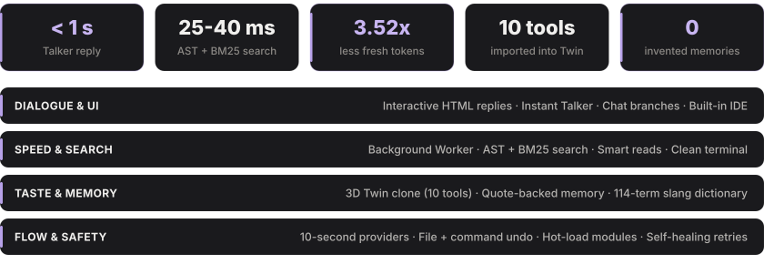
</picture>

</div>

<details>
<summary>Text overview of hero banner, desktop screenshot, and at-a-glance metrics (accessible version)</summary>

- **Hero banner:** `Flecten` - *The desktop coding harness that keeps pace with how you think.*
- **Workspace screenshot (`docs/assets/desktop.png`):** Dark native desktop UI with a top `Agent | IDE` mode toggle, left navigation (`New task`, `Search tasks`, `Twin`, `Dictionary`, `Modules`, project `atlas`), and task tabs (`Conversation`, `Changes`, `History`, `Terminal`, `Worker activity 2`, `Side by side`). Below the header, the 3D furry Twin character confirms `Twin accepted the result: Clean, direct, no fluff.` (`Corrections: 0 / 4`). Inside the reply, an embedded interactive HTML card shows 4 metric tiles (`2 Blockers`, `2 files Scope`, `-62% Steps`, `12 / 12 Tests`), a sortable table (`Cart.tsx` / `Signup gate` / `High` and `api.ts:11` / `Retry key` / `High`), and clickable action buttons (`Apply both`, `GuestFlow only`, `Open in IDE`) labeled `Next step (clicks go straight to the model)`.
- **At-a-glance metrics (`docs/assets/readme/glance-en-dark.svg`):**
  - `< 1 s` Talker reply | `25-40 ms` AST + BM25 search | `3.52x` less fresh tokens | `10 tools` imported into Twin | `0` invented memories
  - **Dialogue & UI:** Interactive HTML replies, Instant Talker, Chat branches, Built-in IDE
  - **Speed & Search:** Background Worker, AST + BM25 search, Smart reads, Clean terminal
  - **Taste & Memory:** 3D Twin clone (10 tools), Quote-backed memory, 114-term slang dictionary
  - **Flow & Safety:** 10-second providers, File + command undo, Hot-load modules, Self-healing retries

</details>

| | | |
| :--- | :--- | :--- |
| **[Interactive HTML Answers](#interactive-html-answers)**<br>Clickable tables, tabs, filters, and two-way actions right inside chat replies. | **[Talker and Worker](#talker-and-worker)**<br>Chat stays sub-second and wide open while code edits and checks run in parallel. | **[Twin (3D Digital Clone)](#twin)**<br>Learns your standards from 10 AI tools and barges in before weak code ships. |
| **[Sniper Search and Speed](#sniper-search-and-speed)**<br>AST + BM25 search, function-aware reads, shared read memory, ~90% cache reuse. | **[Built for Daily Flow](#built-for-daily-flow)**<br>10-second providers, ChatGPT-style branches, rollback for **even shell commands**, built-in IDE. | **[Under the Hood](#under-the-hood)**<br>Hot-load modules, quote-verified memory with zero fan-fiction, 114-term slang dictionary. |

<br>

<p align="center">
  <picture>
    <source media="(prefers-color-scheme: dark)" srcset="docs/assets/readme/strip-html-en-dark.svg">
    <source media="(prefers-color-scheme: light)" srcset="docs/assets/readme/strip-html-en-light.svg">
    
  </picture>
</p>

## Interactive HTML Answers

Most coding harnesses dump a wall of Markdown text and leave you copying file paths by hand or typing `"yes, do option 2"`. In Flecten, the model renders real **interactive mini-apps** directly inside the reply: sortable and filterable tables, comparison tabs, sliders, checkboxes, diagrams, and action buttons wired to your project.

And this is not read-only eye candy. It is a **true two-way loop between you and the model**:

- **Click in the report, move the session:** Select the fixes to keep, flip a toggle, or hit an action button inside the card. Your real choices flow straight back to the agent so it executes the exact path you picked without re-explaining.
- **Four smart delivery rhythms:** Replies can wait quietly until your next message, fire immediately when you hit an action button, trigger right after your first clicks, or give you a brief countdown before continuing.
- **Real human clicks only:** Every action is verified at the browser boundary as a genuine user gesture. Stray scripts inside the report cannot fake clicks or spoof your approval.
- **Jump straight into code:** File and line links inside any table open that exact spot directly inside Flecten's built-in IDE or jump straight to the right Settings pane.
- **Zero-trust offline sandbox:** Each interactive card runs completely isolated with zero network access, zero parent-window access, and zero access to your disk. Live previews start streaming while the model is still typing and stay `-65%` lighter on output tokens than raw sprawling dashboards.

<p align="center">
  <picture>
    <source media="(prefers-color-scheme: dark)" srcset="docs/assets/readme/flow-html-en-dark.svg">
    <source media="(prefers-color-scheme: light)" srcset="docs/assets/readme/flow-html-en-light.svg">
    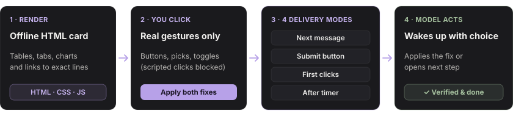
  </picture>
</p>

<details>
<summary>Text version of diagram: Two-way interactive HTML loop</summary>

```text
[1 · RENDER]                [2 · YOU CLICK]               [3 · 4 DELIVERY MODES]       [4 · MODEL ACTS]
Offline HTML card     --->  Real gestures only      --->  - Next message         --->  Wakes up with choice
Tables, tabs, charts        Buttons, picks, toggles       - Submit button              Applies the fix or
& links to exact lines      (scripted clicks blocked)     - First clicks               opens next step
Badge: HTML · CSS · JS      CTA: [Apply both fixes]       - After timer                Status: Verified & done
```

</details>

---

## Talker and Worker

In a single-loop harness, a simple follow-up question gets trapped behind a ten-minute refactor. Wait until tool calls finish, hope the model still remembers what you asked at the top of the prompt, or hit Stop and wipe half its progress.

Flecten splits the job in two like an engineering lead and a focused builder:

- **Talker stays with you (`< 1 s`):** Compiles your plain request into a tight, unambiguous assignment with exact context, answers questions right away, and renders clean progress updates and interactive HTML summaries without blocking your input box.
- **Worker executes in the background:** Reads files, writes patches, spawns parallel subagents, runs tests, and streams live action cards upward while Talker stays free for you.
- **Steer mid-flight without restarts:** Change your mind halfway through and type a quick correction. Talker translates it into a surgical course adjustment for the running Worker without tearing down the session or invalidating prompt cache.
- **Phase compaction that never cheats:** At natural milestones, the Worker compresses sprawling tool trails into crisp summaries anchored to real observed checks. Open work can never quietly mark itself finished without proof.

<p align="center">
  <picture>
    <source media="(prefers-color-scheme: dark)" srcset="docs/assets/readme/flow-talker-worker-en-dark.svg">
    <source media="(prefers-color-scheme: light)" srcset="docs/assets/readme/flow-talker-worker-en-light.svg">
    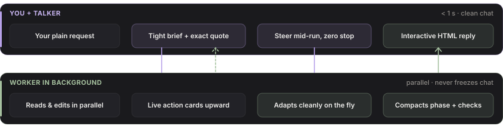
  </picture>
</p>

<details>
<summary>Text version of diagram: Talker and Worker parallel flow</summary>

```text
LANE 1 · YOU + TALKER (< 1 s · clean chat)
  Your plain request  --->  Tight brief + exact quote  --->  Steer mid-run, zero stop  --->  Interactive HTML reply
                                    |                                 |                             ^
                                    v                                 v                             |
LANE 2 · WORKER IN BACKGROUND (parallel · never freezes chat)
  Reads & edits in parallel  --->  Live action cards upward  --->  Adapts cleanly on the fly  --->  Compacts phase + checks
```

</details>

---

## Twin


**Memory handles objective project facts. Twin is about your subjective taste, gut reactions, and the exact moment you lose your patience.** You cannot capture "this layout feels cramped and AI-slop", "stop lecturing me with disclaimers", or "don't turn a two-line tweak into an architecture museum" in a dry spec rule. Twin learns those instincts across **10 AI coding tools** on your machine: Claude Code, Codex, Cursor, OpenCode, Oh-My-Pi, Gemini CLI, Kilo Code, DeepSeek CLI, Command Code, and Flecten itself.

Flecten scans up to **50,000 deduplicated messages** locally first and distills up to **200 living rules** paired with verbatim quotes and an emotional intensity level (`like`, `delight`, or unfiltered `anger`). You control what goes in and toggle Twin per project. While the agent works, Twin watches silently without blocking a step. And when its instincts trip, it **barges straight into the chat in your own voice** inside a pulsing 3D furry bubble. Best part: **the model has zero clue Twin wrote it.** As far as the agent knows, the real user just slammed the brakes on it directly, so it drops the autopilot immediately and fixes it right.

<br clear="all">

<p align="center">
  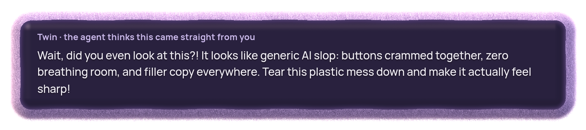
</p>

<br>

<p align="center">
  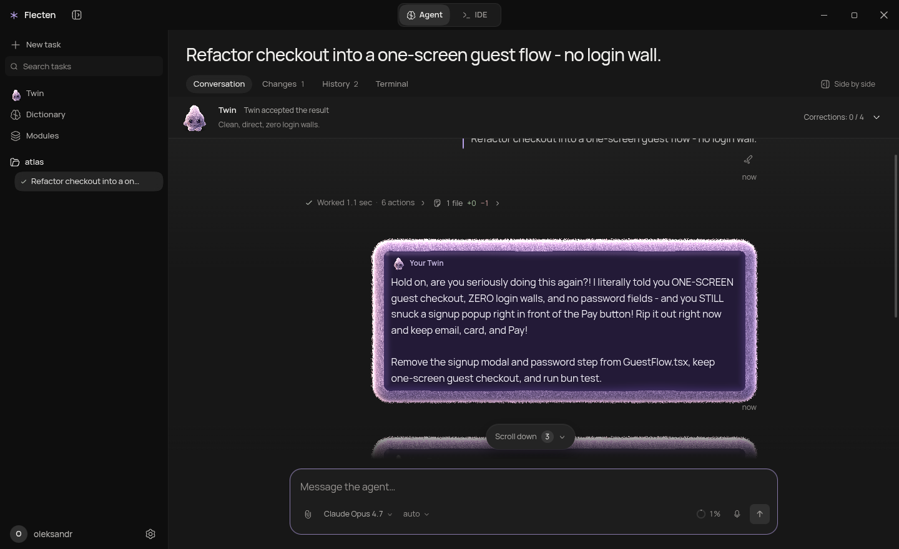
</p>

<br>

<p align="center">
  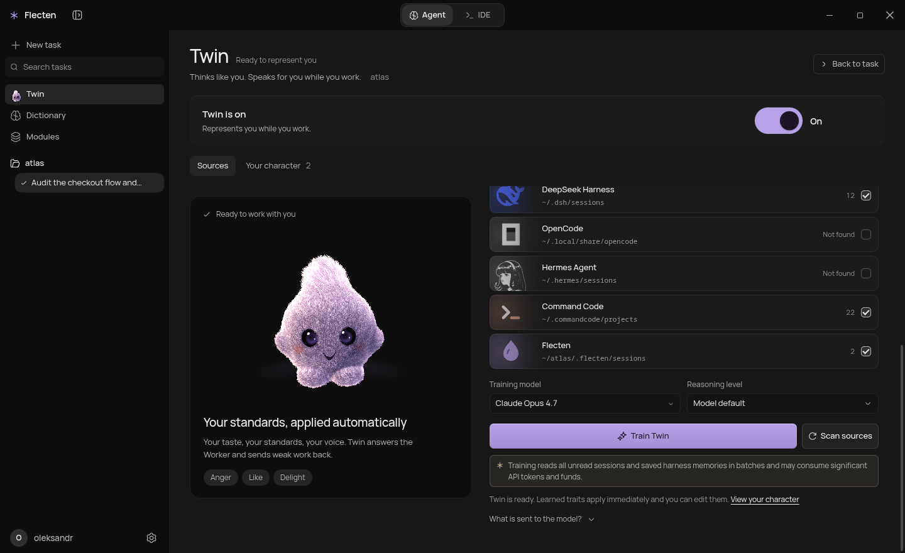
</p>

<details>
<summary>Transcript of Twin screenshots and live barge-in</summary>

- **3D furry bubble quote (`docs/assets/readme/twin-quote-en.png`):**
  > **Twin · the agent thinks this came straight from you:**
  > "Wait, did you even look at this?! It looks like generic AI slop: buttons crammed together, zero breathing room, and filler copy everywhere. Tear this plastic mess down and make it actually feel sharp!"
- **Live task barge-in (`docs/assets/twin-bargein.png`):**
  - **Task:** `Refactor checkout into a one-screen guest flow - no login wall.`
  - **Worker step:** `Worked 1.1 sec · 6 actions · 1 file +0 -1`
  - **Your Twin (in a 3D lilac furry bubble):** "Hold on, are you seriously doing this again?! I literally told you ONE-SCREEN guest checkout, ZERO login walls, and no password fields - and you STILL snuck a signup popup right in front of the Pay button! Rip it out right now and keep email, card, and Pay! Remove the signup modal and password step from GuestFlow.tsx, keep one-screen guest checkout, and run bun test."
  - **Result bar:** `Twin accepted the result: Clean, direct, zero login walls.` (`Corrections: 0 / 4`)
- **Twin setup screen (`docs/assets/twin.png`):** Shows the smiling 3D lilac furry character card (`Your standards, applied automatically`, emotion tags `Anger`, `Like`, `Delight`), per-project `Twin is on` switch, auto-detected session sources (`DeepSeek Harness`, `OpenCode`, `Hermes Agent`, `Command Code`, `Flecten`), `Training model` and `Reasoning level` selectors, `Train Twin` and `Scan sources` controls, plus a `What is sent to the model?` disclosure.

</details>

<br>

<p align="center">
  <picture>
    <source media="(prefers-color-scheme: dark)" srcset="docs/assets/readme/strip-search-en-dark.svg">
    <source media="(prefers-color-scheme: light)" srcset="docs/assets/readme/strip-search-en-light.svg">
    
  </picture>
</p>

## Sniper Search and Speed

Ordinary agents waste the first five turns poking blindly through tests, changelogs, and lookalike filenames before they ever touch the real function. Flecten treats search and context like latency-critical systems code so the agent lands on the right block on turn one and keeps prompt caches warm.

- **Splits compound names into real meaning:** Ask for anything across mixed casing, underscores, hyphens, or abbreviations. Search breaks identifiers into semantic pieces and still handles exact symbols, multi-word code questions, and fast literal grep automatically.
- **Lifts real definitions above noisy matches:** Declarations (functions, classes, hooks, types) float straight to the top while test suites, fixtures, build artifacts, lockfiles, and old docs stay pushed down.
- **Shows top function bodies right inside search:** For the top three matches, Flecten expands the surrounding function right there in the search output. Most of the time the agent skips a follow-up file read completely and edits on turn one (`25-40 ms` search, zero extra round trips).
- **Function-aware reads and shared read memory:** Opening a file snaps cleanly to full function boundaries instead of slicing halfway through logic. Across parallel subagents and background workers, a shared file-state ledger returns crisp compact notices (`304 unchanged` when untouched, or only what changed since last read) instead of burning tokens re-reading identical code.
- **Clean terminal output and hot prompt cache:** Verbose spinners, ANSI garbage, and repetitive progress bars get trimmed before reaching the model, while dynamic state changes sit behind an append-only boundary so `~90%` of every prompt stays cache-hot.

<p align="center">
  <picture>
    <source media="(prefers-color-scheme: dark)" srcset="docs/assets/readme/flow-search-en-dark.svg">
    <source media="(prefers-color-scheme: light)" srcset="docs/assets/readme/flow-search-en-light.svg">
    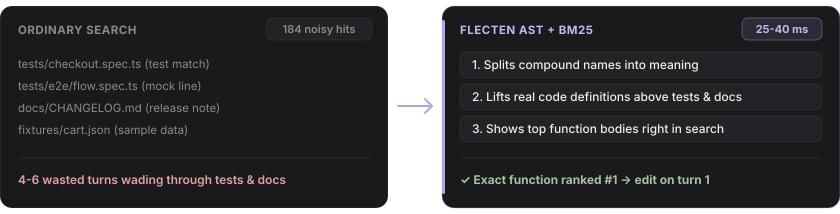
  </picture>
</p>

<details>
<summary>Text version of diagram: Ordinary search vs Flecten AST + BM25</summary>

```text
ORDINARY SEARCH (184 noisy hits)                FLECTEN AST + BM25 (25-40 ms)
  tests/checkout.spec.ts  (test match)            1. Splits compound names into meaning
  tests/e2e/flow.spec.ts  (mock line)             2. Lifts real code definitions above tests & docs
  docs/CHANGELOG.md       (release note)          3. Shows top function bodies right in search
  fixtures/cart.json      (sample data)
-> 4-6 wasted turns wading through noise        -> Exact function ranked #1 -> edit on turn 1
```

</details>

### What this buys you on real runs

| Metric | Before (Typical Harness) | After (Flecten) | Gain |
| :--- | :--- | :--- | :--- |
| **Fresh uncached tokens** | Repeated file dumps & cold prefixes | Shared reads + append-only cache boundary | **`3.52x` fewer tokens** |
| **Multi-file editing speed** | One file per turn & sequential tool waits | Parallel tool batches + inline search hits | **Up to `4.33x` faster** *(real run · v0.1.5)* |
| **Code lookup time** | 4-6 exploratory turns across tests & docs | Structural AST + BM25 ranking + top-3 bodies | **`25-40 ms` · turn-1 hit** |
| **Prompt cache hit rate** | Dynamic inserts break prefix every turn | Stable system + dictionary + dynamic boundary | **`~90%` cached input** *(In theory / benchmarked)* |
| **Interactive report weight** | Bloated multi-turn status walls | Compact semantic tags hydrated in sandbox | **`-65%` summary tokens** |

<br>

<p align="center">
  <picture>
    <source media="(prefers-color-scheme: dark)" srcset="docs/assets/readme/strip-workspace-en-dark.svg">
    <source media="(prefers-color-scheme: light)" srcset="docs/assets/readme/strip-workspace-en-light.svg">
    
  </picture>
</p>

## Built for Daily Flow

### Any provider connected in 10 seconds

Zero hand-editing fragile config files. Pick a service from the live built-in catalog of dozens of providers with automatic model capabilities and pricing, connect local servers (Ollama, LM Studio, vLLM, LocalAI) detected automatically on your machine, or paste any custom endpoint. Sitting behind a restricted corporate gateway that blocks model-list discovery? Flip off automatic discovery and add the model in two clicks.

<p align="center">
  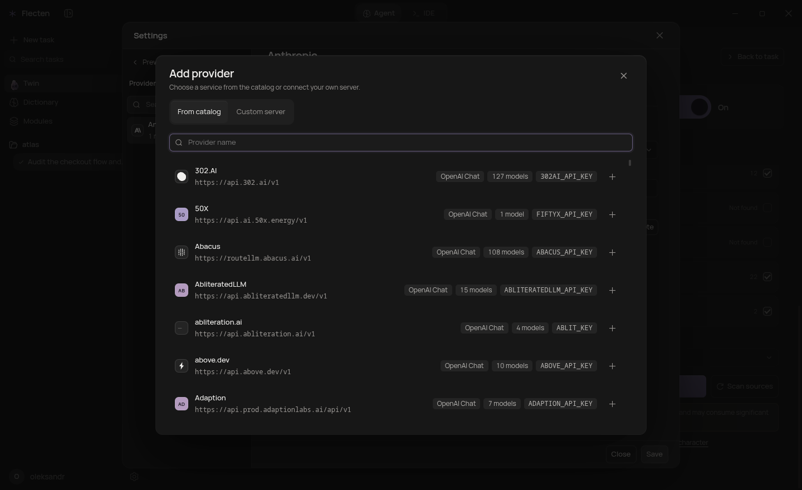
</p>

---

### Message branching like classic ChatGPT

**Want to take back an instruction or compare two directions side by side?** Edit any past user message just like classic ChatGPT and fork a clean alternate continuation. Switch freely between versions with `< 1 / 2 >` at any moment without losing earlier runs or even an unsent draft sitting in the input box.

<p align="center">
  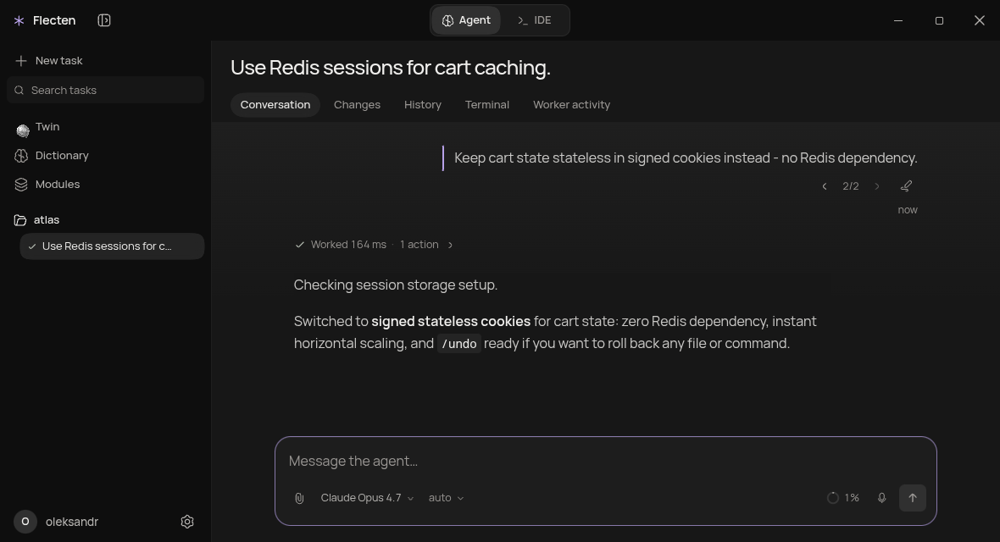
</p>

---

### Roll back files AND EVEN terminal commands


**Most coding agents can only undo edits made through their own file tool. Once a terminal command installs packages, runs a generator, reformats twenty files, or moves folders around, you are on your own cleaning up the mess.** Flecten tracks workspace changes across **both file edits AND shell commands** completely independently of Git.

Shadow snapshots catch what commands actually changed on disk with zero Git commits or dirty-branch juggling: run `/undo` or `/redo` and rewind the whole step cleanly, backed by a warm snapshot cache so hopping back in time feels instant.

<br clear="all">

<p align="center">
  <picture>
    <source media="(prefers-color-scheme: dark)" srcset="docs/assets/readme/flow-timemachine-en-dark.svg">
    <source media="(prefers-color-scheme: light)" srcset="docs/assets/readme/flow-timemachine-en-light.svg">
    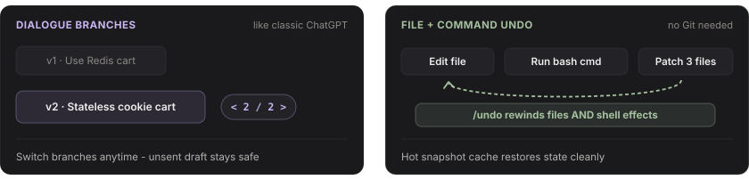
  </picture>
</p>

<details>
<summary>Text version of diagram: Dialogue branches and file + command undo</summary>

```text
DIALOGUE BRANCHES (like classic ChatGPT)        FILE + COMMAND UNDO (no Git needed)
  v1 · Use Redis cart                             [Edit file] -> [Run bash cmd] -> [Patch 3 files]
  v2 · Stateless cookie cart  < 2 / 2 >           /undo rewinds files AND shell effects
  Switch branches anytime; draft stays safe       Hot snapshot cache restores state cleanly
```

</details>

---

### Full built-in IDE one click away

No alt-tabbing back and forth just to tweak three lines or read a diff. Click **IDE** at the top center (or any link inside an interactive HTML answer) to open a crisp workspace with a fast file explorer, syntax editor, inline split diffs for every agent change, line review comments, live terminals, and the agent conversation docked neatly on the right.

<p align="center">
  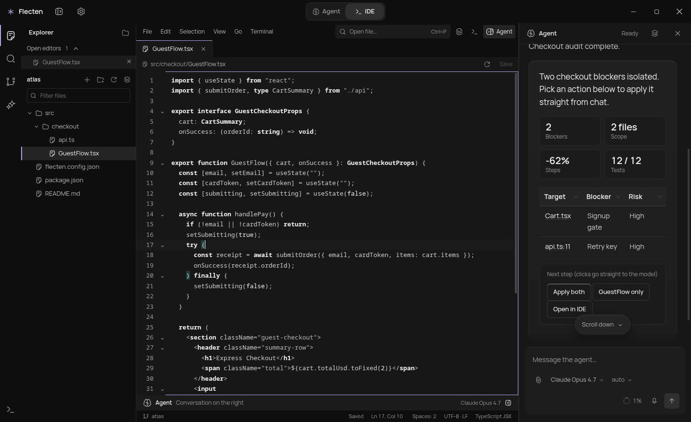
</p>

<br>

<p align="center">
  <picture>
    <source media="(prefers-color-scheme: dark)" srcset="docs/assets/readme/strip-deep-en-dark.svg">
    <source media="(prefers-color-scheme: light)" srcset="docs/assets/readme/strip-deep-en-light.svg">
    
  </picture>
</p>

## Under the Hood

### Hot-load modules that can even reshape the UI

Need custom tools, lifecycle hooks, automated review passes, or even desktop automation (`Computer Use` with screenshot capture, mouse actions, and keyboard input)? Drop a module into Flecten, toggle it on at runtime with zero app restart, and keep your prompt cache intact. Modules can even install a **custom full UI surface** so teams or builders can skin and extend Flecten itself without maintaining a fork.

---

### Honest quote-verified Memory (zero fan-fiction)

Most "AI memory" systems run a noisy background summarizer after every chat that slowly drifts into hallucinated rules and contradicts last week's preferences. Flecten takes the opposite engineering route:

- **Zero background memory bots:** Only the primary agent records memory, strictly when you ask or express a durable preference. Nothing gets guessed from casual chatter.
- **Byte-verified verbatim quotes:** Every stored fact must match a real quote you actually typed in this session or earlier. If a model cannot ground a memory in your own exact words, the store rejects it on the spot.
- **Lifecycle superseding instead of rule rot:** Switching databases, testing frameworks, or formatting styles updates and cleanly replaces the conflicting entry rather than stacking contradicting rules forever.
- **Secret-proof and transparent:** API keys, tokens, and credentials are caught and blocked before persistence. Every rule stays human-readable, searchable, and editable directly inside Settings whenever you want to trim or change it.

---

### Zero-latency slang and broken-layout Dictionary

Every developer writes shorthand like `fix auth flow`, `make it pop`, or forgets to switch keyboard layouts and sends `ghbdtn` or `rfr ltkf?`. Flecten ships with a curated **114-term built-in engineering dictionary** spanning English, Russian, and Ukrainian slang plus instant broken keyboard-layout recovery (`EN <-> RU/UK`) in **0 ms** before any token hits the API. Your team can add project acronyms and internal jargon right alongside it so models understand you verbatim on the first try without burning extra explanation turns.

---

## Everything you already love in other harnesses (yes, we have that too)

No sales essays for table stakes. Just the checklist:

| | | | |
| :--- | :--- | :--- | :--- |
| **MCP** (`stdio`, `HTTP`, `OAuth`) | **Skills** | **Lifecycle Hooks** | **Parallel Subagents** |
| **Access Modes & Permission Rules** | **OS Sandbox** (`bwrap` / `Seatbelt` / Win) | **LSP Symbols & Diagnostics** | **Git Diffs & PR Context** |
| **Image & Vision Input** | **Voice Input** (Whisper / Groq) | **Live Background Translation** | **Computer Use** |
| **Background Jobs & Terminal** | **Web Search & Fetch** | **Custom Slash Commands** | **Inline `@file` Mentions** |
| **Reasoning Effort Levels** | **Token & USD Cost Budgets** | **Session Search & Export** | **Message Queue & Steering** |
| **Multi-Project Switcher** | **Module Marketplace** | **7 UI Languages** | **Signed Delta Auto-Updates** |

---

## Self-Healing Error Handling

Providers stall, drop streams mid-JSON, rotate rate limits, and hit output ceilings. Flecten absorbs those bumps quietly in the background:

- **Automatic stream recovery:** Detects empty completions, cut-off arguments, and reasoning-only drops, retrying cleanly with backoff instead of bricking your task halfway through.
- **Adaptive failover and cooldowns:** Steps through fallback models on outages or rate limits, quarantining unhealthy endpoints automatically while resetting budget trackers only for healthy turns.
- **Self-repairing edits:** Fuzzy line-matching fixes minor whitespace or indentation drift automatically instead of bouncing every small patch back as a failure.
- **Protected context window:** Oversized files, binary dumps, and giant tool responses are clamped cleanly at every boundary so one runaway log never overflows your context.

---

## Quick Start

### Option 1: Install the desktop app (recommended)

Download the installer for your OS from [GitHub Releases](https://github.com/AnnenkovLabs/flecten/releases):
- **Windows:** `.exe` installer
- **Linux:** `.AppImage` or `.deb`
- **macOS:** `.dmg`

### Option 2: Run or build from source

Requires **[Bun](https://bun.sh) 1.4.4+**:

```bash
git clone https://github.com/AnnenkovLabs/flecten.git
cd flecten
bun install
bun run app:dev
```

<details>
<summary>Upgrading from Liquid Harness?</summary>

Existing `~/.liquidharness`, `.liquidharness/`, and `liquid.config.json` project data is automatically recognized and migrated safely into `.flecten/` and `flecten.config.json` on first launch.

</details>

---

## Documentation

| Guide | Topic |
| :--- | :--- |
| [Twin](docs/TWIN.md) | 3D taste clone, 10-tool history import, background watch & barge-in |
| [Talker and Worker](docs/TALKER-WORKER.md) | Dual-agent split, live steering, phase acceptance |
| [Memory](docs/MEMORY.md) | Quote-verified durable memory & secret protection |
| [Dictionary](docs/DICTIONARY.md) | Zero-latency slang, glossary & keyboard-layout repair |
| [Modules](docs/MODULES.md) | Hot-load plugins, custom tools & UI replacement |
| [Computer Use](docs/COMPUTER-USE.md) | Screen, mouse & keyboard automation module |
| [Voice](docs/VOICE.md) | Local Whisper & Groq push-to-talk dictation |
| [Provider Protection](docs/PROVIDER-PROTECTION.md) | Adaptive safety & endpoint cooldown rules |
| [Benchmarks](docs/BENCHMARK.md) | Real comparative runs & latency measurements |
| [Architecture](docs/ARCHITECTURE.md) | System boundaries, layers & security model |

<div align="center">

<br>


Licensed under **[AGPL-3.0](LICENSE)** · Made by [AnnenkovLabs](https://github.com/AnnenkovLabs/flecten) · [Changelog](CHANGELOG.md)

</div>
