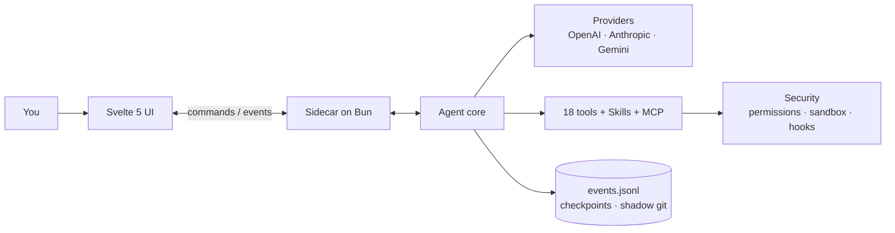

<div align="center">


# Flecten

**El espacio de trabajo de escritorio para agentes de código.**
Conversaciones, archivos, herramientas y cambios en una sola ventana.

[](https://github.com/AnnenkovLabs/flecten/actions/workflows/ci.yml)
[](../../LICENSE)
[](https://bun.sh)
[](https://www.typescriptlang.org)
[](https://svelte.dev)
[](https://www.electronjs.org)
[](../../CONTRIBUTING.md)

[English](../../README.md) · [简体中文](README.zh-Hans.md) · [Português (Brasil)](README.pt-BR.md) · [Español](README.es.md) · [日本語](README.ja.md) · [Українська](README.uk.md) · [Русский](README.ru.md)

</div>


<p align="center"><sub>Vista previa con un proveedor de demostración local.</sub></p>

> [!WARNING]
> **Versión alfa.** Ahora mismo hay muchos bugs y muchas cosas sin terminar. En los próximos días estoy poniendo el máximo esfuerzo en pulir y dejar todo a punto. Espera cambios rápidos y, por favor, [reporta lo que se rompa](https://github.com/AnnenkovLabs/flecten/issues).

## ⚡ Por qué Flecten

El bucle del agente es lo básico. Flecten corrige lo que se rompe después de la demo.

| El problema que ya conoces | Lo que hace Flecten |
|---|---|
| 🔇 Conversar y programar en un chat degrada ambos, y dirigir al agente significa interrumpirlo | **Talker y Worker** corren como sesiones separadas: sigue hablando, dirige a mitad de tarea, detén solo el worker |
| 💭 Cada chat nuevo olvida tu proyecto y tus correcciones | **Memoria de proyecto** basada en tus propias palabras, entre sesiones |
| 📖 Malinterpreta los términos y la jerga de tu proyecto | Un **diccionario** da al modelo tus definiciones exactas antes de responder |
| 🔌 Conectar un proveedor es arqueología en JSON | Pega una **base URL y una API key**; Flecten configura el proveedor e importa todos los modelos de la API |
| 🧱 Un resultado grande es un muro de markdown | **Respuestas HTML interactivas**: tablas ordenables, pestañas, gráficos, botones |
| 🪞 Trabaja como un asistente genérico, no como tú | Un **Twin** que aprende tu voz y rechaza trabajo que no es tuyo |

<p align="center">
<b>18</b> herramientas integradas &nbsp;·&nbsp; <b>4</b> protocolos de proveedor &nbsp;·&nbsp; <b>7</b> idiomas de interfaz &nbsp;·&nbsp; <b>85%</b> umbral de cobertura
</p>

## 🚀 Inicio rápido

Requiere [Bun](https://bun.sh) 1.4 o superior.

```bash
bun install
export OPENAI_API_KEY=...
bun run app:dev
```

`bun run app:dev` inicia Vite, lanza el núcleo en Bun y abre una ventana de Electron con hot reload. El directorio actual es la raíz del proyecto; define `FLECTEN_CWD` para trabajar en otro lugar.

```bash
# u otro proveedor
FLECTEN_PROVIDER=anthropic FLECTEN_MODEL=claude-sonnet-4-6 bun run app:dev
```

Para ver la interfaz en un navegador sin el núcleo, ejecuta `bun run dev:ui`.

## ✨ Lo que hace diferente a Flecten

### 🗣️ Habla mientras trabaja

**Sigue hablando mientras el Worker trabaja.**
Los chats nuevos se dividen en un Talker en tu idioma y un Worker con una tarea concreta. Dirige a mitad de tarea, haz preguntas o detén solo el Worker. Cada llamada es una tarjeta en vivo con su propio registro y botón de parada.

### 🖥️ Un IDE completo, a un clic

**Agent e IDE en la misma ventana.**
Cambia la cabecera a IDE: árbol de archivos, pestañas de editor, búsqueda y reemplazo en el proyecto, ir a línea, control de versiones, terminal. La conversación sigue disponible como una isla.

### 🩹 Diffs en los que puedes confiar

**Revisa cada edición. Deshaz sin cirugía en git.**
Cada cambio llega como un diff; acepta o descarta por archivo. Guardar comprueba la versión en disco, así que un conflicto nunca pisa tu borrador. Los checkpoints y un git en la sombra dan `/undo` y `/redo`.

### 🧠 Memoria que sobrevive al chat

**Tu proyecto, recordado entre sesiones.**
El modelo decide qué guardar: preferencias, lecciones, decisiones. Cada entrada se basa en tus palabras, con versión y tema. Las entradas obsoletas se invalidan solas.

### 📖 Un diccionario para tus términos

**Tu vocabulario, resuelto antes de llamar al modelo.**
Un diccionario público de diseño e IA se sincroniza desde GitHub; los términos locales del proyecto tienen prioridad. La coincidencia difusa incluso corrige erratas de teclado: `мшиусщвштп` → `vibecoding`. Tu mensaje queda palabra por palabra.

### 🔌 Proveedores en un clic

**Elige de un catálogo, no de un JSON.**
Añade un servicio conocido con logotipos y modelos, o apunta a tu propio servidor. Flecten comprueba la conexión y descubre los modelos. Cuatro protocolos, con failover visible cuando uno cae.

### 📊 Respuestas en HTML interactivo

**Un resultado con el que interactuar, no solo leer.**
Las respuestas finales pueden ser HTML en sandbox: tablas ordenables, pestañas, gráficos y botones que abren ajustes o un archivo. Renderizado mientras llega el stream, sin red ni scripts externos.

### 🪞 Aprende tu voz

**Un Twin que trabaja como tú, no como un asistente genérico.**
Aprende de tus sesiones y fuentes anteriores, escribe specs en tus términos y rechaza trabajo que no es tuyo. La memoria y un perfil cierran el ciclo.

## ✅ Y todo lo demás que esperas

| | Área | Qué incluye |
|---|---|---|
| 🛠️ | Herramientas | 18 integradas: `read`, `write`, `edit`, `apply_patch`, `delete`, `move`, `todo`, `task`, `grep`, `glob`, `ask`, `web_fetch`, `web_search`, `terminal`, `bash`, `jobs`, `memory`, `done`; además de `skill` y `module` |
| 🛡️ | Seguridad | permisos `deny` / `auto` / `ask` / `allow`, sandbox bubblewrap / seatbelt, hooks de comandos y aprobaciones que esperan dentro de la llamada |
| 💻 | Terminal | un PTY persistente por sesión, `jobs` en segundo plano con registros y `wait`, y cancelación del árbol de procesos |
| 🔁 | Ejecuciones | tareas en paralelo, una cola que sobrevive a recargas, steering, recuperación tras una caída del núcleo y presupuestos de tokens, coste y tiempo por ejecución |
| 🧩 | Extensiones | Agent Skills, MCP por stdio y HTTP con OAuth, hooks y módulos que agrupan herramientas, instrucciones y servicios |
| 📎 | Entrada | imágenes, PDF y audio; referencias `@` a archivos, símbolos, tareas y PR públicos de GitHub; un menú slash; entrada de voz |
| 📝 | Salida | Markdown, Mermaid y un visor integrado de archivos y registros |
| 🌍 | Alcance | 7 idiomas de interfaz, actualización automática firmada y telemetría con consentimiento explícito |

## 🏗️ Arquitectura

La interfaz nunca lee archivos ni llama a modelos. Envía comandos a un sidecar en Bun mediante un protocolo JSONL y recibe eventos tipados. El núcleo nunca importa Electron ni la interfaz.



Los eventos llevan `seq`, `ts` y `schemaVersion`, así que una ventana reabierta reconstruye la tarea desde `events.jsonl` y se pone al día con el stream en vivo desde su cursor.

## 🔗 Conecta tu stack

El proveedor por defecto es `openai` con `gpt-5.1`. Las claves vienen de variables de entorno: `OPENAI_API_KEY`, `ANTHROPIC_API_KEY`, `OPENROUTER_API_KEY`, `DEEPSEEK_API_KEY`. Cualquier servicio compatible se añade en la ventana o en `flecten.config.json`:

```json
{
  "provider": "local",
  "model": "qwen3-coder",
  "providers": {
    "local": {
      "protocol": "openai-chat",
      "baseUrl": "http://127.0.0.1:11434/v1"
    }
  }
}
```

Un proveedor sin clave funciona sin autenticación, lo que conviene a servidores locales. Los campos avanzados definen `headers`, `proxy` y `transportTimeoutMs`; la clave puede venir de `apiKeyEnv` o de un `auth.command`. Elige el nivel de razonamiento en el compositor: `auto`, `low`, `medium`, `high`.

- 🧩 Las **Skills** se cargan desde `~/.agents/skills` y el `.agents/skills` del proyecto; el modelo ve un catálogo y abre un `SKILL.md` completo bajo demanda.
- 🔌 Los servidores **MCP** exponen sus herramientas, recursos y prompts, con OAuth discovery y PKCE.
- 🪝 Los **hooks** pueden bloquear el arranque, un prompt o una herramienta; un hook con `failClosed` bloquea la acción si falla.
- 📦 Los **módulos** agrupan herramientas, instrucciones, hooks y servicios, y se activan por tarea tras revisar su contenido.

```json
{
  "mcp": {
    "servers": {
      "docs": { "command": "bun", "args": ["mcp/docs-server.ts"] }
    }
  },
  "hooks": {
    "preToolUse": [
      { "command": "bun .agents/hooks/guard.ts", "matcher": "bash" }
    ]
  }
}
```

> ⚠️ La configuración del proyecto con MCP, hooks o skills lanza procesos. Ábrela solo en un repositorio en el que confíes.

Contrato completo: [docs/EXTENSIONS.md](../EXTENSIONS.md).

## ⌨️ Comandos

| Comando | Qué hace |
|---|---|
| `bun run app:dev` | Abrir una ventana de Electron con hot reload |
| `bun run app` | Compilar la interfaz y el núcleo, y abrir la ventana |
| `bun run dev:ui` | Ejecutar la interfaz en un navegador sin Electron |
| `bun run build:ui` | Compilar `ui/dist` |
| `bun run build:agent` | Compilar el binario del núcleo en `dist/flecten-agent` |
| `bun test` | Pruebas del núcleo y de la lógica pura de la interfaz |
| `bun run check` | Ejecutar `tsc` y `svelte-check` |
| `bun run lint` | Biome y reglas del proyecto (tamaño de archivos, regex, módulos muertos) |
| `bun run verify` | Pruebas, tipos, lint, comprobación de docs y ambas compilaciones |
| `bun run test:e2e` | E2E con Playwright en Electron, con regresión visual en 1480x940 y 1180x640 |
| `bun run coverage` | Comprobar la cobertura de líneas frente al umbral del 85% |
| `bun run package` | Crear un paquete de Electron sin empaquetar en `release/` |
| `bun run release` | Crear un instalador para la plataforma actual |

Un cambio no está listo hasta que pasa `bun run verify`.

## 📚 Documentación

- 🏗️ [Arquitectura](../ARCHITECTURE.md) · 🗣️ [Talker y Worker](../TALKER-WORKER.md) · 🧠 [Memoria](../MEMORY.md) · 📖 [Diccionario](../DICTIONARY.md)
- 🧩 [Extensiones](../EXTENSIONS.md) · 📦 [Módulos](../MODULES.md) · 🎙️ [Voz](../VOICE.md)
- 🗂️ [Estructura](../STRUCTURE.md) · 🎨 [Diseño](../../design.md) · 📐 [Convenciones](../CONVENTIONS.md)
- 🚢 [Release](../RELEASE.md) · 📝 [Changelog](../../CHANGELOG.md) · 🖼️ [Guía de la interfaz](../../ui/README.md) · 🐚 [Guía del shell](../../shell/README.md)

## 🚦 Estado

La base del agente funciona y está cubierta por pruebas y capturas. En progreso: la firma de releases, el sandbox de Windows, el aislamiento de recursos por comando y la aceptación nativa por plataforma. El PTY de Windows usa ConPTY de Bun 1.4.2.

La actualización automática usa `FLECTEN_UPDATE_URL` y verifica un manifiesto Ed25519 con una clave pública incrustada antes de descargar el instalador.

## 🤝 Contribuir

Antes de abrir un PR, lee [CONTRIBUTING.md](../../CONTRIBUTING.md) y [CODE_OF_CONDUCT.md](../../CODE_OF_CONDUCT.md). Reporta vulnerabilidades según [SECURITY.md](../../SECURITY.md), no en un issue público.

## 📄 Licencia

AGPL-3.0. Ver [LICENSE](../../LICENSE). Libre para usar, modificar y compartir; las normas de la comunidad están en [ETHICS.md](../../ETHICS.md) y el [Código de conducta](../../CODE_OF_CONDUCT.md).

---

<p align="center"><sub>Flecten se llamaba antes Liquid Harness. Los archivos <code>liquid.config.json</code>, las variables <code>LIQUID_*</code>, los enlaces <code>liquid-harness://</code> y los perfiles guardados siguen funcionando. Los nombres principales ahora son <code>flecten.config.json</code>, <code>FLECTEN_*</code> y <code>flecten://</code>. La carpeta <code>.liquid/</code> conserva sesiones, adjuntos y checkpoints sin migración de datos.</sub></p>

<p align="center"><sub>La interfaz inicia en inglés. Elige un idioma en <b>Ajustes → General → Idioma de la interfaz</b>. La elección se guarda en este dispositivo y es independiente del idioma de las respuestas del agente.</sub></p>
