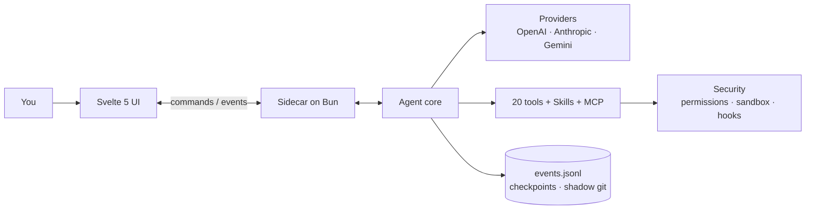

<div align="center">


# Flecten

**コーディングエージェントのためのデスクトップワークスペース。**
会話、ファイル、ツール、変更をひとつのウィンドウに。

[](https://github.com/AnnenkovLabs/flecten/actions/workflows/ci.yml)
[](../../LICENSE)
[](https://bun.sh)
[](https://www.typescriptlang.org)
[](https://svelte.dev)
[](https://www.electronjs.org)
[](../../CONTRIBUTING.md)

[English](../../README.md) · [简体中文](README.zh-Hans.md) · [Português (Brasil)](README.pt-BR.md) · [Español](README.es.md) · [日本語](README.ja.md) · [Українська](README.uk.md) · [Русский](README.ru.md)

</div>


<p align="center"><sub>ローカルのデモプロバイダーでのプレビュー。</sub></p>

> [!WARNING]
> **アルファ版。** 現在はバグも未完成の部分も数多くあります。ここ数日は、磨き上げて完成度を高めるために最大限の力を注いでいます。急速な変更を想定し、[不具合を報告](https://github.com/AnnenkovLabs/flecten/issues)してください。

## ⚡ なぜ Flecten か

エージェントループは前提です。Flecten はデモの後に壊れる部分を修正します。

| あなたがすでに知っている問題 | Flecten の答え |
|---|---|
| 🔇 会話とコーディングを1つのチャットで行うと両方の品質が落ち、指示を出すには中断するしかない | **Talker と Worker** が別セッションで動作: 会話を続け、タスク途中で指示し、worker だけを停止 |
| 💭 新しいチャットはプロジェクトとあなたの修正を忘れる | **プロジェクトメモリ** があなた自身の言葉に基づき、セッションをまたいで保持 |
| 📖 プロジェクトの用語やジャーゴンを誤解する | **辞書** が回答前にあなたの正確な定義をモデルへ渡す |
| 🔌 プロバイダー接続は JSON の考古学 | **base URL と API キー**を貼り付けるだけ。Flecten がプロバイダーを設定し、API から全モデルを取り込む |
| 🧱 大きな結果は markdown の壁 | **インタラクティブな HTML 回答**: 並べ替え可能なテーブル、タブ、チャート、ボタン |
| 🪞 汎用アシスタントとして動き、あなたらしくない | **Twin** があなたの声を学び、あなたらしくない成果を拒否 |

<p align="center">
<b>20</b> 組み込みツール &nbsp;·&nbsp; <b>4</b> プロバイダープロトコル &nbsp;·&nbsp; <b>7</b> インターフェース言語 &nbsp;·&nbsp; <b>85%</b> カバレッジ基準
</p>

## 🚀 クイックスタート

[Bun](https://bun.sh) 1.4 以降が必要です。

```bash
bun install
export OPENAI_API_KEY=...
bun run app:dev
```

`bun run app:dev` は Vite を起動し、Bun 上でコアを立ち上げ、ホットリロード付きの Electron ウィンドウを開きます。現在のディレクトリがプロジェクトルートです。別の場所で作業するには `FLECTEN_CWD` を設定します。

```bash
# または別のプロバイダー
FLECTEN_PROVIDER=anthropic FLECTEN_MODEL=claude-sonnet-4-6 bun run app:dev
```

コアなしでブラウザでインターフェースを確認するには `bun run dev:ui` を実行します。

## ✨ Flecten が違うところ

### 🗣️ 作業中も会話できる

**Worker の実行中も会話を続けられます。**
新しいチャットはあなたの言語の Talker と、特定の課題を持つ Worker に分かれます。タスク途中で指示し、質問し、Worker だけを停止できます。各呼び出しは専用のログと停止ボタンを持つライブカードです。

### 🖥️ ワンクリックで本格的な IDE

**Agent と IDE を同じウィンドウに。**
ヘッダーを IDE に切り替え: ファイルツリー、エディタータブ、プロジェクト全体の検索と置換、行への移動、ソース管理、ターミナル。会話は島としてそのまま利用できます。

### 🩹 信頼できる差分

**すべての編集をレビュー。git の外科手術なしで取り消し。**
各変更は差分として届き、ファイルごとに承認または破棄できます。保存時にディスク上のバージョンを確認するため、競合が下書きを上書きしません。チェックポイントとシャドウ git が `/undo` と `/redo` を実現します。

### 🧠 チャットを越えて残るメモリ

**プロジェクトをセッションをまたいで記憶。**
何を残すかはモデルが判断: 好み、教訓、決定。各エントリはあなた自身の言葉に基づき、バージョンとトピックを持ちます。古くなったエントリは自ら無効化されます。

### 📖 あなたの用語のための辞書

**モデルを呼ぶ前にあなたの語彙を解決。**
デザインと AI の公開辞書が GitHub から同期され、プロジェクトのローカル用語が優先されます。あいまい一致は配列の打ち間違いも修正: `мшиусщвштп` → `vibecoding`。メッセージは一言一句そのままです。

### 🔌 ワンクリックでプロバイダー追加

**JSON ではなくカタログから選択。**
ロゴとモデル一覧を備えた既知サービスを追加するか、自分のサーバーを指定します。Flecten が接続を確認し、モデルを発見します。4 プロトコル、障害時には可視化された failover。

### 📊 生きた HTML の回答

**読むだけでなく操作できる結果。**
最終回答はサンドボックス化された HTML にできます: 並べ替え可能なテーブル、タブ、チャート、設定やファイルを開くボタン。ストリームに合わせてレンダリングされ、ネットワークも外部スクリプトもありません。

### 🪞 あなたの声を学ぶ

**汎用アシスタントではなく、あなたのように動く Twin。**
過去のセッションやソースから学び、あなたの言葉で仕様を書き、あなたらしくない成果を拒否します。メモリとプロフィールが循環を閉じます。

## ✅ そのほか期待されるすべて

| | 領域 | 内容 |
|---|---|---|
| 🛠️ | ツール | 20 組み込み: `read`, `write`, `edit`, `apply_patch`, `delete`, `move`, `todo`, `task`, `grep`, `glob`, `ask`, `web_fetch`, `web_search`, `git`, `lsp`, `terminal`, `bash`, `jobs`, `memory`, `done`。さらに `skill` と `module` |
| 🛡️ | 安全性 | `deny` / `auto` / `ask` / `allow` の権限、bubblewrap / seatbelt サンドボックス、コマンドフック、呼び出し内で待機する承認 |
| 💻 | ターミナル | セッションごとの永続 PTY、ログと `wait` を備えたバックグラウンド `jobs`、プロセスツリーのキャンセル |
| 🔁 | 実行 | 並列タスク、再読み込みを生き残るキュー、steering、コアクラッシュ後の復旧、実行ごとのトークン・コスト・時間予算 |
| 🧩 | 拡張 | Agent Skills、OAuth 付き stdio / HTTP の MCP、フック、ツール・指示・サービスをまとめるモジュール |
| 📎 | 入力 | 画像、PDF、音声。ファイル・シンボル・タスク・公開 GitHub PR への `@` 参照、スラッシュメニュー、音声入力 |
| 📝 | 出力 | Markdown、Mermaid、組み込みのファイル・ログビューアー |
| 🌍 | 対応範囲 | 7 インターフェース言語、署名付き自動更新、明示的同意によるテレメトリ |

## 🏗️ アーキテクチャ

インターフェースはファイルを読まず、モデルも呼びません。JSONL プロトコルで Bun のサイドカーにコマンドを送り、型付きイベントを受け取ります。コアは Electron もインターフェースもインポートしません。



イベントは `seq`、`ts`、`schemaVersion` を持つため、開き直したウィンドウは `events.jsonl` からタスクを再構築し、カーソル位置からライブストリームに追いつきます。

## 🔗 スタックを接続する

既定のプロバイダーは `gpt-5.1` の `openai` です。キーは環境変数から取得します: `OPENAI_API_KEY`, `ANTHROPIC_API_KEY`, `OPENROUTER_API_KEY`, `DEEPSEEK_API_KEY`。互換サービスはウィンドウまたは `flecten.config.json` で追加できます:

```json
{
  "provider": "local",
  "model": "qwen3-coder",
  "providers": {
    "local": {
      "protocol": "openai-chat",
      "baseUrl": "http://127.0.0.1:11434/v1"
    }
  }
}
```

キーのないプロバイダーは認証なしで動作し、ローカルサーバーに適します。詳細フィールドで `headers`、`proxy`、`transportTimeoutMs` を設定できます。キーは `apiKeyEnv` または `auth.command` から取得できます。推論レベルはコンポーザーで選択します: `auto`, `low`, `medium`, `high`。

- 🧩 **Skills** は `~/.agents/skills` とプロジェクトの `.agents/skills` から読み込まれます。モデルはカタログを見て、必要に応じて完全な `SKILL.md` を開きます。
- 🔌 **MCP** サーバーはツール、リソース、プロンプトを公開し、OAuth discovery と PKCE に対応します。
- 🪝 **フック**は起動、プロンプト、ツールをブロックでき、`failClosed` のフックは失敗時に操作をブロックします。
- 📦 **モジュール**はツール、指示、フック、サービスをまとめ、内容のレビュー後にタスクごとに有効化されます。

```json
{
  "mcp": {
    "servers": {
      "docs": { "command": "bun", "args": ["mcp/docs-server.ts"] }
    }
  },
  "hooks": {
    "preToolUse": [
      { "command": "bun .agents/hooks/guard.ts", "matcher": "bash" }
    ]
  }
}
```

> ⚠️ MCP、フック、skills を含むプロジェクト設定はプロセスを起動します。信頼できるリポジトリでのみ開いてください。

完全な契約: [docs/EXTENSIONS.md](../EXTENSIONS.md)。

## ⌨️ コマンド

| コマンド | 内容 |
|---|---|
| `bun run app:dev` | ホットリロード付きの Electron ウィンドウを開く |
| `bun run app` | インターフェースとコアをビルドしてウィンドウを開く |
| `bun run dev:ui` | Electron なしでブラウザでインターフェースを実行 |
| `bun run build:ui` | `ui/dist` をビルド |
| `bun run build:agent` | コアバイナリを `dist/flecten-agent` にビルド |
| `bun test` | コアと純粋なインターフェースロジックのテスト |
| `bun run check` | `tsc` と `svelte-check` を実行 |
| `bun run lint` | Biome とプロジェクトルール（ファイルサイズ、regex、デッドモジュール） |
| `bun run verify` | テスト、型、リント、ドキュメントチェック、両方のビルド |
| `bun run test:e2e` | Electron での Playwright E2E。1480x940 と 1180x640 の視覚回帰付き |
| `bun run coverage` | 85% の基準に対する行カバレッジを確認 |
| `bun run package` | `release/` に未パッケージの Electron パッケージを作成 |
| `bun run release` | 現在のプラットフォーム向けインストーラーを作成 |

変更は `bun run verify` を通過するまで完成ではありません。

## 📚 ドキュメント

- 🏗️ [アーキテクチャ](../ARCHITECTURE.md) · 🗣️ [Talker と Worker](../TALKER-WORKER.md) · 🧠 [メモリ](../MEMORY.md) · 📖 [辞書](../DICTIONARY.md)
- 🧩 [拡張](../EXTENSIONS.md) · 📦 [モジュール](../MODULES.md) · 🎙️ [音声](../VOICE.md)
- 🗂️ [構成](../STRUCTURE.md) · 🎨 [デザイン](../../design.md) · 🧭 [決定](../DECISIONS.md) · 📐 [規約](../CONVENTIONS.md)
- 🚢 [リリース](../RELEASE.md) · 📝 [Changelog](../../CHANGELOG.md) · 🖼️ [インターフェースガイド](../../ui/README.md) · 🐚 [シェルガイド](../../shell/README.md)

## 🚦 ステータス

エージェントの基盤は動作し、テストとスナップショットでカバーされています。対応中: リリースの署名、Windows サンドボックス、コマンドごとのリソース分離、ネイティブプラットフォームの受け入れテスト。Windows PTY は Bun 1.4.2 の ConPTY を使用します。

自動更新は `FLECTEN_UPDATE_URL` を使用し、インストーラーをダウンロードする前に埋め込み公開鍵で Ed25519 マニフェストを検証します。

## 🤝 コントリビュート

PR を開く前に [CONTRIBUTING.md](../../CONTRIBUTING.md) と [CODE_OF_CONDUCT.md](../../CODE_OF_CONDUCT.md) を読んでください。脆弱性は公開 issue ではなく [SECURITY.md](../../SECURITY.md) に従って報告してください。

## 📄 ライセンス

MIT。[LICENSE](../../LICENSE) を参照。

---

<p align="center"><sub>Flecten は以前 Liquid Harness と呼ばれていました。既存の <code>liquid.config.json</code> ファイル、<code>LIQUID_*</code> 変数、<code>liquid-harness://</code> リンク、保存済みプロフィールは引き続き動作します。主な名前は現在 <code>flecten.config.json</code>、<code>FLECTEN_*</code>、<code>flecten://</code> です。<code>.liquid/</code> フォルダーはデータ移行なしでセッション、添付、チェックポイントを保持します。</sub></p>

<p align="center"><sub>インターフェースは英語で起動します。<b>設定 → 一般 → インターフェースの言語</b>で言語を選択できます。選択はこのデバイスに保存され、エージェントの回答言語とは独立しています。</sub></p>
