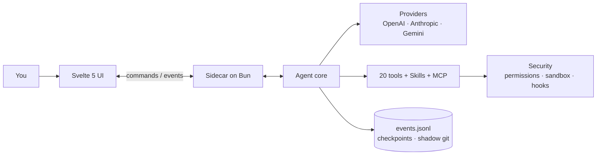

<div align="center">


# Flecten

**O ambiente de trabalho desktop para agentes de código.**
Conversas, arquivos, ferramentas e mudanças em uma só janela.

[](https://github.com/AnnenkovLabs/flecten/actions/workflows/ci.yml)
[](../../LICENSE)
[](https://bun.sh)
[](https://www.typescriptlang.org)
[](https://svelte.dev)
[](https://www.electronjs.org)
[](../../CONTRIBUTING.md)

[English](../../README.md) · [简体中文](README.zh-Hans.md) · [Português (Brasil)](README.pt-BR.md) · [Español](README.es.md) · [日本語](README.ja.md) · [Українська](README.uk.md) · [Русский](README.ru.md)

</div>


<p align="center"><sub>Prévia com um provedor de demonstração local.</sub></p>

> [!WARNING]
> **Versão alfa.** Neste momento há muitos bugs e muita coisa inacabada. Nos próximos dias estou colocando o máximo de esforço para polir e deixar tudo redondo. Espere mudanças rápidas e, por favor, [relate o que quebrar](https://github.com/AnnenkovLabs/flecten/issues).

## ⚡ Por que Flecten

O loop do agente é o básico. Flecten corrige o que quebra depois da demo.

| O problema que você já conhece | O que o Flecten faz |
|---|---|
| 🔇 Conversar e programar em um chat degrada ambos, e direcionar o agente significa interrompê-lo | **Talker e Worker** rodam como sessões separadas: continue conversando, direcione no meio da tarefa, pare só o worker |
| 💭 Cada novo chat esquece o seu projeto e as suas correções | **Memória de projeto** baseada nas suas próprias palavras, entre sessões |
| 📖 Ele interpreta mal os termos e o jargão do seu projeto | Um **dicionário** entrega ao modelo as suas definições exatas antes de responder |
| 🔌 Conectar um provedor é arqueologia em JSON | Cole uma **base URL e uma API key**; o Flecten configura o provedor e importa todos os modelos da API |
| 🧱 Um resultado grande é um muro de markdown | **Respostas HTML interativas**: tabelas ordenáveis, abas, gráficos, botões |
| 🪞 Ele trabalha como um assistente genérico, não como você | Um **Twin** que aprende a sua voz e rejeita trabalho que não é seu |

<p align="center">
<b>20</b> ferramentas integradas &nbsp;·&nbsp; <b>4</b> protocolos de provedor &nbsp;·&nbsp; <b>7</b> idiomas de interface &nbsp;·&nbsp; <b>85%</b> limite de cobertura
</p>

## 🚀 Início rápido

Requer [Bun](https://bun.sh) 1.4 ou mais recente.

```bash
bun install
export OPENAI_API_KEY=...
bun run app:dev
```

`bun run app:dev` inicia o Vite, sobe o núcleo no Bun e abre uma janela do Electron com hot reload. O diretório atual é a raiz do projeto; defina `FLECTEN_CWD` para trabalhar em outro lugar.

```bash
# ou outro provedor
FLECTEN_PROVIDER=anthropic FLECTEN_MODEL=claude-sonnet-4-6 bun run app:dev
```

Para ver a interface em um navegador sem o núcleo, execute `bun run dev:ui`.

## ✨ O que torna o Flecten diferente

### 🗣️ Converse enquanto ele trabalha

**Continue conversando enquanto o Worker trabalha.**
Novos chats se dividem em um Talker no seu idioma e um Worker com uma tarefa focada. Direcione no meio da tarefa, faça perguntas ou pare só o Worker. Cada chamada é um card ao vivo com seu próprio log e botão de parar.

### 🖥️ Uma IDE completa, a um clique

**Agent e IDE na mesma janela.**
Mude o cabeçalho para IDE: árvore de arquivos, abas de editor, busca e substituição no projeto, ir para linha, controle de versão, terminal. A conversa continua disponível como uma ilha.

### 🩹 Diffs em que você pode confiar

**Revise cada edição. Desfaça sem cirurgia no git.**
Cada mudança chega como um diff; aceite ou descarte por arquivo. Salvar verifica a versão em disco, então um conflito nunca atropela o seu rascunho. Checkpoints e um git sombra dão `/undo` e `/redo`.

### 🧠 Memória que sobrevive ao chat

**Seu projeto, lembrado entre sessões.**
O modelo decide o que guardar: preferências, lições, decisões. Cada entrada se baseia nas suas palavras, com versão e tópico. Entradas obsoletas se invalidam sozinhas.

### 📖 Um dicionário para os seus termos

**Seu vocabulário, resolvido antes de chamar o modelo.**
Um dicionário público de design e IA sincroniza do GitHub; os termos locais do projeto têm prioridade. A correspondência difusa até corrige erros de teclado: `мшиусщвштп` → `vibecoding`. A sua mensagem fica palavra por palavra.

### 🔌 Provedores em um clique

**Escolha de um catálogo, não de um JSON.**
Adicione um serviço conhecido com logotipos e modelos, ou aponte para o seu próprio servidor. O Flecten testa a conexão e descobre os modelos. Quatro protocolos, com failover visível quando um cai.

### 📊 Respostas em HTML interativo

**Um resultado para interagir, não só ler.**
As respostas finais podem ser HTML em sandbox: tabelas ordenáveis, abas, gráficos e botões que abrem configurações ou um arquivo. Renderizado conforme o stream chega, sem rede nem scripts externos.

### 🪞 Ele aprende a sua voz

**Um Twin que trabalha como você, não como um assistente genérico.**
Ele aprende com as suas sessões e fontes anteriores, escreve specs nos seus termos e rejeita trabalho que não é seu. A memória e um perfil fecham o ciclo.

## ✅ E tudo o mais que você espera

| | Área | O que inclui |
|---|---|---|
| 🛠️ | Ferramentas | 20 integradas: `read`, `write`, `edit`, `apply_patch`, `delete`, `move`, `todo`, `task`, `grep`, `glob`, `ask`, `web_fetch`, `web_search`, `git`, `lsp`, `terminal`, `bash`, `jobs`, `memory`, `done`; além de `skill` e `module` |
| 🛡️ | Segurança | permissões `deny` / `auto` / `ask` / `allow`, sandbox bubblewrap / seatbelt, hooks de comandos e aprovações que esperam dentro da chamada |
| 💻 | Terminal | um PTY persistente por sessão, `jobs` em segundo plano com logs e `wait`, e cancelamento da árvore de processos |
| 🔁 | Execuções | tarefas em paralelo, uma fila que sobrevive a recargas, steering, recuperação após uma queda do núcleo e orçamentos de tokens, custo e tempo por execução |
| 🧩 | Extensões | Agent Skills, MCP por stdio e HTTP com OAuth, hooks e módulos que agrupam ferramentas, instruções e serviços |
| 📎 | Entrada | imagens, PDF e áudio; referências `@` a arquivos, símbolos, tarefas e PRs públicos do GitHub; um menu slash; entrada de voz |
| 📝 | Saída | Markdown, Mermaid e um visualizador integrado de arquivos e logs |
| 🌍 | Alcance | 7 idiomas de interface, atualização automática assinada e telemetria com consentimento explícito |

## 🏗️ Arquitetura

A interface nunca lê arquivos nem chama modelos. Ela envia comandos a um sidecar no Bun por um protocolo JSONL e recebe eventos tipados. O núcleo nunca importa o Electron nem a interface.



Os eventos carregam `seq`, `ts` e `schemaVersion`, então uma janela reaberta reconstrói a tarefa a partir de `events.jsonl` e alcança o stream ao vivo a partir do seu cursor.

## 🔗 Conecte a sua stack

O provedor padrão é `openai` com `gpt-5.1`. As chaves vêm de variáveis de ambiente: `OPENAI_API_KEY`, `ANTHROPIC_API_KEY`, `OPENROUTER_API_KEY`, `DEEPSEEK_API_KEY`. Qualquer serviço compatível pode ser adicionado na janela ou em `flecten.config.json`:

```json
{
  "provider": "local",
  "model": "qwen3-coder",
  "providers": {
    "local": {
      "protocol": "openai-chat",
      "baseUrl": "http://127.0.0.1:11434/v1"
    }
  }
}
```

Um provedor sem chave funciona sem autenticação, o que serve a servidores locais. Campos avançados definem `headers`, `proxy` e `transportTimeoutMs`; a chave pode vir de `apiKeyEnv` ou de um `auth.command`. Escolha o nível de raciocínio no compositor: `auto`, `low`, `medium`, `high`.

- 🧩 As **Skills** carregam de `~/.agents/skills` e do `.agents/skills` do projeto; o modelo vê um catálogo e abre um `SKILL.md` completo sob demanda.
- 🔌 Servidores **MCP** expõem suas ferramentas, recursos e prompts, com OAuth discovery e PKCE.
- 🪝 **Hooks** podem bloquear a inicialização, um prompt ou uma ferramenta; um hook com `failClosed` bloqueia a ação quando falha.
- 📦 **Módulos** agrupam ferramentas, instruções, hooks e serviços, ativados por tarefa após revisão do conteúdo.

```json
{
  "mcp": {
    "servers": {
      "docs": { "command": "bun", "args": ["mcp/docs-server.ts"] }
    }
  },
  "hooks": {
    "preToolUse": [
      { "command": "bun .agents/hooks/guard.ts", "matcher": "bash" }
    ]
  }
}
```

> ⚠️ A configuração do projeto com MCP, hooks ou skills inicia processos. Abra-a apenas em um repositório em que você confia.

Contrato completo: [docs/EXTENSIONS.md](../EXTENSIONS.md).

## ⌨️ Comandos

| Comando | O que faz |
|---|---|
| `bun run app:dev` | Abrir uma janela do Electron com hot reload |
| `bun run app` | Compilar a interface e o núcleo, e abrir a janela |
| `bun run dev:ui` | Rodar a interface em um navegador sem Electron |
| `bun run build:ui` | Compilar `ui/dist` |
| `bun run build:agent` | Compilar o binário do núcleo em `dist/flecten-agent` |
| `bun test` | Testes do núcleo e da lógica pura da interface |
| `bun run check` | Rodar `tsc` e `svelte-check` |
| `bun run lint` | Biome e regras do projeto (tamanho de arquivos, regex, módulos mortos) |
| `bun run verify` | Testes, tipos, lint, verificação de docs e ambas as compilações |
| `bun run test:e2e` | E2E com Playwright no Electron, com regressão visual em 1480x940 e 1180x640 |
| `bun run coverage` | Verificar a cobertura de linhas contra o limite de 85% |
| `bun run package` | Criar um pacote do Electron não empacotado em `release/` |
| `bun run release` | Criar um instalador para a plataforma atual |

Uma mudança não está pronta até passar em `bun run verify`.

## 📚 Documentação

- 🏗️ [Arquitetura](../ARCHITECTURE.md) · 🗣️ [Talker e Worker](../TALKER-WORKER.md) · 🧠 [Memória](../MEMORY.md) · 📖 [Dicionário](../DICTIONARY.md)
- 🧩 [Extensões](../EXTENSIONS.md) · 📦 [Módulos](../MODULES.md) · 🎙️ [Voz](../VOICE.md)
- 🗂️ [Estrutura](../STRUCTURE.md) · 🎨 [Design](../../design.md) · 🧭 [Decisões](../DECISIONS.md) · 📐 [Convenções](../CONVENTIONS.md)
- 🚢 [Release](../RELEASE.md) · 📝 [Changelog](../../CHANGELOG.md) · 🖼️ [Guia da interface](../../ui/README.md) · 🐚 [Guia do shell](../../shell/README.md)

## 🚦 Status

A base do agente funciona e é coberta por testes e capturas. A revisão de aceitação de 10 de novembro fechou **217 de 221** itens.

Ainda abertos: a assinatura real de releases, o sandbox do Windows, o isolamento de recursos por comando e a aceitação nativa por plataforma. O PTY do Windows usa ConPTY do Bun 1.4.2.

A atualização automática usa `FLECTEN_UPDATE_URL` e verifica um manifesto Ed25519 com uma chave pública embutida antes de baixar o instalador. Leia o [relatório de aceitação](../ACCEPTANCE-2026-11-10.md) e a [lista de implementação](../IMPLEMENTATION-CHECKLIST.md).

## 🤝 Contribuindo

Antes de abrir um PR, leia [CONTRIBUTING.md](../../CONTRIBUTING.md) e [CODE_OF_CONDUCT.md](../../CODE_OF_CONDUCT.md). Relate vulnerabilidades conforme [SECURITY.md](../../SECURITY.md), não em uma issue pública.

## 📄 Licença

MIT. Veja [LICENSE](../../LICENSE).

---

<p align="center"><sub>O Flecten antes se chamava Liquid Harness. Arquivos <code>liquid.config.json</code>, variáveis <code>LIQUID_*</code>, links <code>liquid-harness://</code> e perfis salvos continuam funcionando. Os nomes principais agora são <code>flecten.config.json</code>, <code>FLECTEN_*</code> e <code>flecten://</code>. A pasta <code>.liquid/</code> mantém sessões, anexos e checkpoints sem migração de dados.</sub></p>

<p align="center"><sub>A interface inicia em inglês. Escolha um idioma em <b>Configurações → Geral → Idioma da interface</b>. A escolha é salva neste dispositivo e é separada do idioma das respostas do agente.</sub></p>
