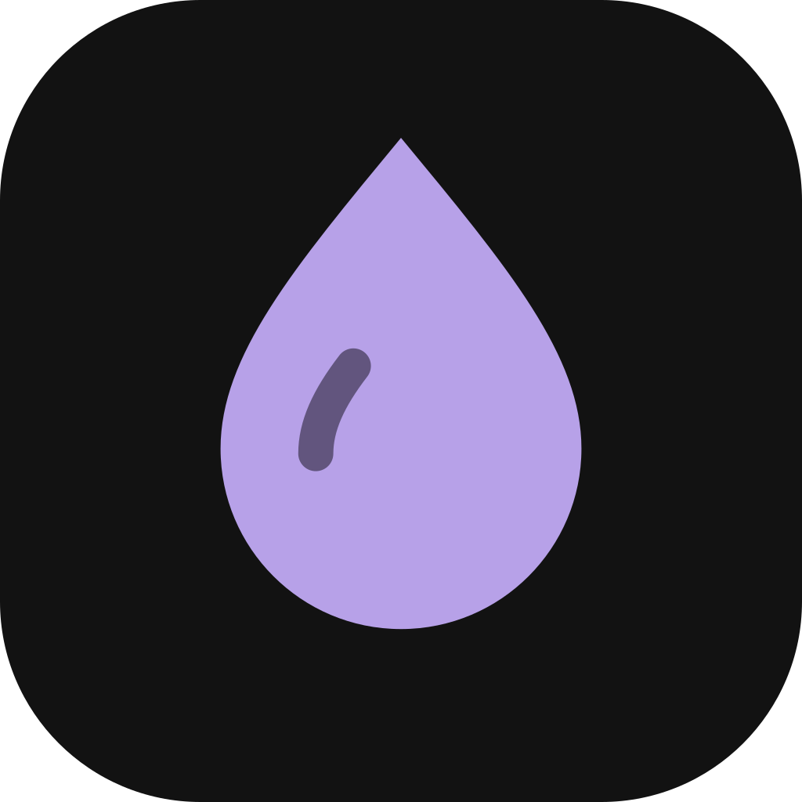
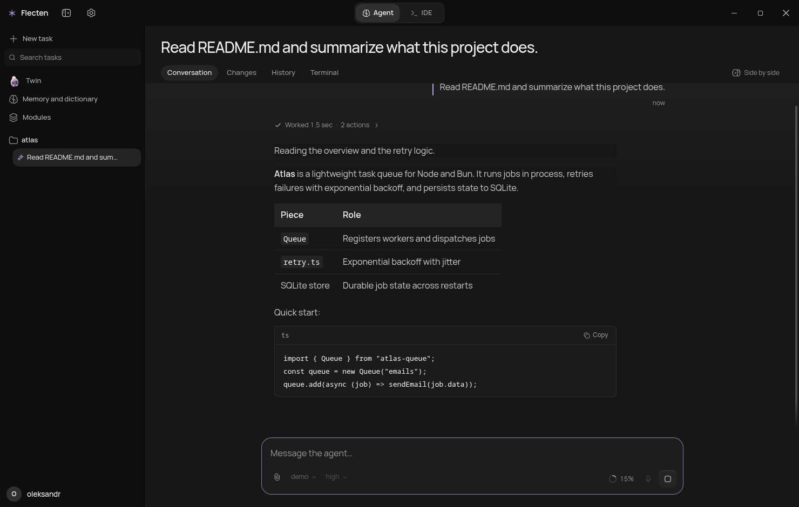
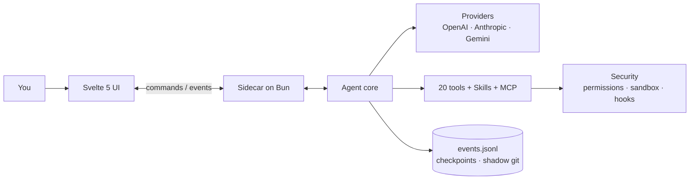

<div align="center">



# Flecten

**Настольная среда для агентов, которые пишут код.**
Переписка, файлы, инструменты и изменения в одном окне.

[](https://github.com/AnnenkovLabs/flecten/actions/workflows/ci.yml)
[](../../LICENSE)
[](https://bun.sh)
[](https://www.typescriptlang.org)
[](https://svelte.dev)
[](https://www.electronjs.org)
[](../../CONTRIBUTING.md)

[English](../../README.md) · [简体中文](README.zh-Hans.md) · [Português (Brasil)](README.pt-BR.md) · [Español](README.es.md) · [日本語](README.ja.md) · [Українська](README.uk.md) · [Русский](README.ru.md)

</div>



<p align="center"><sub>Превью на локальном демо-провайдере.</sub></p>

> [!WARNING]
> **Альфа-версия.** Сейчас здесь много багов и много недоделок. В ближайшие дни я прикладываю максимум усилий, чтобы отполировать и довести всё до ума. Ожидайте быстрых изменений и, пожалуйста, [сообщайте о том, что ломается](https://github.com/AnnenkovLabs/flecten/issues).

## ⚡ Зачем Flecten

Агентный цикл это база. Flecten исправляет то, что ломается после демо.

| Проблема, которая вам знакома | Что делает Flecten |
|---|---|
| 🔇 Общение и кодинг в одном чате снижают качество обоих, а направить агента значит прервать | **Talker и Worker** работают как отдельные сессии: продолжайте разговор, направляйте посреди задачи, остановите только worker |
| 💭 Каждый новый чат забывает проект и ваши правки | **Память проекта** на основе ваших реальных слов, между сессиями |
| 📖 Он неверно понимает термины и жаргон проекта | **Словарь** передаёт модели ваши точные определения до ответа |
| 🔌 Подключить провайдера значит археологию в JSON | Вставьте **base URL и API-ключ**; Flecten настроит провайдера и импортирует все модели из API |
| 🧱 Большой результат это стена markdown | **Интерактивные HTML-ответы**: сортируемые таблицы, вкладки, графики, кнопки |
| 🪞 Он работает как обычный ассистент, а не как вы | **Twin**, который учится вашему голосу и отклоняет не вашу работу |

<p align="center">
<b>20</b> встроенных инструментов &nbsp;·&nbsp; <b>4</b> протокола провайдеров &nbsp;·&nbsp; <b>7</b> языков интерфейса &nbsp;·&nbsp; <b>85%</b> порог покрытия
</p>

## 🚀 Быстрый старт

Нужен [Bun](https://bun.sh) 1.4 или новее.

```bash
bun install
export OPENAI_API_KEY=...
bun run app:dev
```

`bun run app:dev` запускает Vite, поднимает ядро на Bun и открывает окно Electron с hot reload. Текущий каталог это корень проекта; задайте `FLECTEN_CWD`, чтобы работать в другом месте.

```bash
# или другой провайдер
FLECTEN_PROVIDER=anthropic FLECTEN_MODEL=claude-sonnet-4-6 bun run app:dev
```

Чтобы посмотреть интерфейс в браузере без ядра, выполните `bun run dev:ui`.

## ✨ Чем Flecten отличается

### 🗣️ Разговаривайте, пока идёт работа

**Продолжайте разговор, пока Worker работает.**
Новые чаты делятся на Talker на вашем языке и Worker с отдельным заданием. Направляйте посреди задачи, задавайте вопросы или остановите только Worker. Каждый вызов это живая карточка со своим логом и кнопкой остановки.

### 🖥️ Полноценная IDE в одном переключении

**Agent и IDE в одном окне.**
Переключите шапку на IDE: дерево файлов, вкладки редактора, поиск и замена по проекту, переход к строке, контроль версий, терминал. Разговор остаётся доступным как остров.

### 🩹 Диффы, которым можно доверять

**Проверяйте каждую правку. Откат без хирургии в git.**
Каждое изменение приходит как дифф; принимайте или отклоняйте по файлам. Сохранение сверяет версию на диске, поэтому конфликт не затрёт черновик. Checkpoint и теневой git дают `/undo` и `/redo`.

### 🧠 Память, которая переживает чат

**Ваш проект помнится между сессиями.**
Модель решает, что сохранить: предпочтения, уроки, решения. Каждая запись на основе ваших слов, с версией и темой. Устаревшие записи снимаются сами.

### 📖 Словарь ваших терминов

**Ваш словарь уточняется до обращения к модели.**
Публичный словарь дизайна и ИИ синхронизируется с GitHub; локальные термины проекта в приоритете. Нечёткий поиск даже исправляет опечатки раскладки: `мшиусщвштп` → `vibecoding`. Сообщение остаётся слово в слово.

### 🔌 Провайдеры в один клик

**Выбирайте из каталога, а не из JSON.**
Добавьте известный сервис с логотипами и моделями или укажите свой сервер. Flecten проверяет соединение и находит модели. Четыре протокола и видимый failover при сбое.

### 📊 Ответы в виде живого HTML

**Результат, с которым можно взаимодействовать, а не только читать.**
Финальные ответы могут быть HTML в песочнице: сортируемые таблицы, вкладки, графики и кнопки, открывающие настройки или файл. Рендер по мере потока, без сети и внешних скриптов.

### 🪞 Он учится вашему голосу

**Twin, который работает как вы, а не как обычный ассистент.**
Он учится на ваших прошлых сессиях и источниках, пишет спеки в ваших терминах и отклоняет не вашу работу. Память и профиль замыкают цикл.

## ✅ И всё остальное, что вы ожидаете

| | Область | Что есть |
|---|---|---|
| 🛠️ | Инструменты | 20 встроенных: `read`, `write`, `edit`, `apply_patch`, `delete`, `move`, `todo`, `task`, `grep`, `glob`, `ask`, `web_fetch`, `web_search`, `git`, `lsp`, `terminal`, `bash`, `jobs`, `memory`, `done`; плюс `skill` и `module` |
| 🛡️ | Безопасность | права `deny` / `auto` / `ask` / `allow`, песочница bubblewrap / seatbelt, хуки команд и approvals с ожиданием внутри вызова |
| 💻 | Терминал | persistent PTY на сессию, фоновые `jobs` с логами и `wait`, отмена дерева процессов |
| 🔁 | Прогоны | параллельные задачи, очередь переживает перезагрузку, steering, восстановление после падения ядра, лимиты токенов, стоимости и времени на прогон |
| 🧩 | Расширения | Agent Skills, MCP через stdio и HTTP с OAuth, хуки и модули, объединяющие инструменты, инструкции и сервисы |
| 📎 | Ввод | изображения, PDF и аудио; `@` ссылки на файлы, символы, задачи и публичные GitHub PR; slash-меню; голосовой ввод |
| 📝 | Вывод | Markdown, Mermaid и встроенный просмотрщик файлов и логов |
| 🌍 | Охват | 7 языков интерфейса, подписанное автообновление и телеметрия по явному согласию |

## 🏗️ Архитектура

Интерфейс не читает файлы и не вызывает модели. Он отправляет команды sidecar на Bun по JSONL-протоколу и получает типизированные события. Ядро не импортирует Electron и интерфейс.



События несут `seq`, `ts` и `schemaVersion`, поэтому переоткрытое окно собирает задачу из `events.jsonl` и догоняет живой поток с курсора.

## 🔗 Подключите свой стек

Провайдер по умолчанию это `openai` с `gpt-5.1`. Ключи берутся из переменных окружения: `OPENAI_API_KEY`, `ANTHROPIC_API_KEY`, `OPENROUTER_API_KEY`, `DEEPSEEK_API_KEY`. Любой совместимый сервис добавляется в окне или в `flecten.config.json`:

```json
{
  "provider": "local",
  "model": "qwen3-coder",
  "providers": {
    "local": {
      "protocol": "openai-chat",
      "baseUrl": "http://127.0.0.1:11434/v1"
    }
  }
}
```

Провайдер без ключа работает без аутентификации, что удобно для локальных серверов. Advanced-поля задают `headers`, `proxy` и `transportTimeoutMs`; ключ можно взять из `apiKeyEnv` или `auth.command`. Уровень рассуждения выбирается в композере: `auto`, `low`, `medium`, `high`.

- 🧩 **Skills** загружаются из `~/.agents/skills` и проектного `.agents/skills`; модель видит каталог и открывает полный `SKILL.md` по требованию.
- 🔌 **MCP** серверы отдают свои инструменты, ресурсы и промпты, с OAuth discovery и PKCE.
- 🪝 **Хуки** могут блокировать запуск, промпт или инструмент; хук с `failClosed` блокирует действие при падении.
- 📦 **Модули** объединяют инструменты, инструкции, хуки и сервисы и подключаются под задачу после проверки содержимого.

```json
{
  "mcp": {
    "servers": {
      "docs": { "command": "bun", "args": ["mcp/docs-server.ts"] }
    }
  },
  "hooks": {
    "preToolUse": [
      { "command": "bun .agents/hooks/guard.ts", "matcher": "bash" }
    ]
  }
}
```

> ⚠️ Конфигурация проекта с MCP, хуками или skills запускает процессы. Открывайте её только в репозитории, которому доверяете.

Полный контракт: [docs/EXTENSIONS.md](../EXTENSIONS.md).

## ⌨️ Команды

| Команда | Что делает |
|---|---|
| `bun run app:dev` | Открыть окно Electron с hot reload |
| `bun run app` | Собрать интерфейс и ядро, затем открыть окно |
| `bun run dev:ui` | Запустить интерфейс в браузере без Electron |
| `bun run build:ui` | Собрать `ui/dist` |
| `bun run build:agent` | Собрать бинарник ядра в `dist/flecten-agent` |
| `bun test` | Тесты ядра и чистой логики интерфейса |
| `bun run check` | `tsc` и `svelte-check` |
| `bun run lint` | Biome и правила проекта (размер файлов, regex, мёртвые модули) |
| `bun run verify` | Тесты, типы, линт, проверка документации и обе сборки |
| `bun run test:e2e` | Playwright E2E в Electron с визуальной регрессией на 1480x940 и 1180x640 |
| `bun run coverage` | Проверка покрытия строк против порога 85% |
| `bun run package` | Несобранный пакет Electron в `release/` |
| `bun run release` | Установщик для текущей платформы |

Правка не готова, пока не проходит `bun run verify`.

## 📚 Документация

- 🏗️ [Архитектура](../ARCHITECTURE.md) · 🗣️ [Talker и Worker](../TALKER-WORKER.md) · 🧠 [Память](../MEMORY.md) · 📖 [Словарь](../DICTIONARY.md)
- 🧩 [Расширения](../EXTENSIONS.md) · 📦 [Модули](../MODULES.md) · 🎙️ [Голос](../VOICE.md)
- 🗂️ [Структура](../STRUCTURE.md) · 🎨 [Дизайн](../../design.md) · 📐 [Соглашения](../CONVENTIONS.md)
- 🚢 [Релиз](../RELEASE.md) · 📝 [Changelog](../../CHANGELOG.md) · 🖼️ [Гайдлайны интерфейса](../../ui/README.md) · 🐚 [Гайдлайны оболочки](../../shell/README.md)

## 🚦 Статус

База агента работает и покрыта тестами и снимками. В работе: подпись релизов, песочница Windows, изоляция ресурсов каждой команды и native платформенная приёмка. Windows PTY использует ConPTY из Bun 1.4.2.

Автообновление использует `FLECTEN_UPDATE_URL` и проверяет Ed25519 manifest встроенным публичным ключом до загрузки установщика.

## 🤝 Участие

Перед PR прочитайте [CONTRIBUTING.md](../../CONTRIBUTING.md) и [CODE_OF_CONDUCT.md](../../CODE_OF_CONDUCT.md). Об уязвимостях сообщайте по [SECURITY.md](../../SECURITY.md), а не в публичном issue.

## 📄 Лицензия

AGPL-3.0. См. [LICENSE](../../LICENSE). Свободно используйте, изменяйте и распространяйте; нормы сообщества в [ETHICS.md](../../ETHICS.md) и [Кодексе поведения](../../CODE_OF_CONDUCT.md).

---

<p align="center"><sub>Flecten раньше назывался Liquid Harness. Существующие файлы <code>liquid.config.json</code>, переменные <code>LIQUID_*</code>, ссылки <code>liquid-harness://</code> и сохранённые профили продолжают работать. Основные имена теперь <code>flecten.config.json</code>, <code>FLECTEN_*</code> и <code>flecten://</code>. Папка <code>.liquid/</code> хранит сессии, вложения и checkpoints без миграции данных.</sub></p>

<p align="center"><sub>Интерфейс запускается на английском. Выберите язык в <b>Настройки → Общее → Язык интерфейса</b>. Выбор сохраняется на этом устройстве и не зависит от языка ответов агента.</sub></p>
