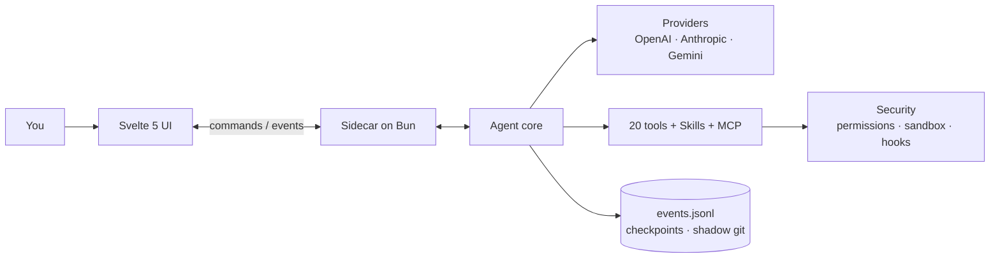

<div align="center">


# Flecten

**Настільне середовище для агентів, які пишуть код.**
Листування, файли, інструменти та зміни в одному вікні.

[](https://github.com/AnnenkovLabs/flecten/actions/workflows/ci.yml)
[](../../LICENSE)
[](https://bun.sh)
[](https://www.typescriptlang.org)
[](https://svelte.dev)
[](https://www.electronjs.org)
[](../../CONTRIBUTING.md)

[English](../../README.md) · [简体中文](README.zh-Hans.md) · [Português (Brasil)](README.pt-BR.md) · [Español](README.es.md) · [日本語](README.ja.md) · [Українська](README.uk.md) · [Русский](README.ru.md)

</div>


<p align="center"><sub>Прев'ю на локальному демо-провайдері.</sub></p>

> [!WARNING]
> **Альфа-версія.** Зараз тут багато багів і багато недоробок. Найближчими днями я докладаю максимум зусиль, щоб відполірувати та довести все до розуму. Очікуйте швидких змін і, будь ласка, [повідомляйте про те, що ламається](https://github.com/AnnenkovLabs/flecten/issues).

## ⚡ Навіщо Flecten

Агентний цикл це база. Flecten виправляє те, що ламається після демо.

| Проблема, яка вам знайома | Що робить Flecten |
|---|---|
| 🔇 Спілкування і кодинг в одному чаті знижують якість обох, а спрямувати агента означає перервати | **Talker і Worker** працюють як окремі сесії: продовжуйте розмову, спрямовуйте посеред задачі, зупиніть лише worker |
| 💭 Кожен новий чат забуває проєкт і ваші правки | **Пам'ять проєкту** на основі ваших реальних слів, між сесіями |
| 📖 Він неправильно розуміє терміни та жаргон проєкту | **Словник** передає моделі ваші точні визначення до відповіді |
| 🔌 Підключити провайдера означає археологію в JSON | Вставте **base URL і API-ключ**; Flecten налаштує провайдера та імпортує всі моделі з API |
| 🧱 Великий результат це стіна markdown | **Інтерактивні HTML-відповіді**: сортовані таблиці, вкладки, графіки, кнопки |
| 🪞 Він працює як звичайний асистент, а не як ви | **Twin**, що вчиться вашому голосу й відхиляє не вашу роботу |

<p align="center">
<b>20</b> вбудованих інструментів &nbsp;·&nbsp; <b>4</b> протоколи провайдерів &nbsp;·&nbsp; <b>7</b> мов інтерфейсу &nbsp;·&nbsp; <b>85%</b> поріг покриття
</p>

## 🚀 Швидкий старт

Потрібен [Bun](https://bun.sh) 1.4 або новіший.

```bash
bun install
export OPENAI_API_KEY=...
bun run app:dev
```

`bun run app:dev` запускає Vite, піднімає ядро на Bun і відкриває вікно Electron з hot reload. Поточний каталог це корінь проєкту; задайте `FLECTEN_CWD`, щоб працювати в іншому місці.

```bash
# або інший провайдер
FLECTEN_PROVIDER=anthropic FLECTEN_MODEL=claude-sonnet-4-6 bun run app:dev
```

Щоб подивитися інтерфейс у браузері без ядра, виконайте `bun run dev:ui`.

## ✨ Чим Flecten вирізняється

### 🗣️ Спілкуйтеся, поки йде робота

**Продовжуйте розмову, поки Worker працює.**
Нові чати діляться на Talker вашою мовою та Worker з окремим завданням. Спрямовуйте посеред задачі, ставте запитання або зупиніть лише Worker. Кожен виклик це жива картка зі своїм логом і кнопкою зупинки.

### 🖥️ Повноцінна IDE в одному перемиканні

**Agent і IDE в одному вікні.**
Перемкніть шапку на IDE: дерево файлів, вкладки редактора, пошук і заміна по проєкту, перехід до рядка, контроль версій, термінал. Розмова лишається доступною як острів.

### 🩹 Дифи, яким можна довіряти

**Перевіряйте кожну правку. Відкат без хірургії в git.**
Кожна зміна приходить як диф; приймайте або відхиляйте по файлах. Збереження звіряє версію на диску, тож конфлікт не затре чернетку. Checkpoint і тіньовий git дають `/undo` і `/redo`.

### 🧠 Пам'ять, що переживає чат

**Ваш проєкт пам'ятається між сесіями.**
Модель вирішує, що зберегти: вподобання, уроки, рішення. Кожен запис на основі ваших слів, з версією та темою. Застарілі записи знімаються самі.

### 📖 Словник ваших термінів

**Ваш словник уточнюється до звернення до моделі.**
Публічний словник дизайну та ШІ синхронізується з GitHub; локальні терміни проєкту в пріоритеті. Нечіткий пошук навіть виправляє помилки розкладки: `мшиусщвштп` → `vibecoding`. Повідомлення лишається слово в слово.

### 🔌 Провайдери в один клік

**Обирайте з каталогу, а не з JSON.**
Додайте відомий сервіс з логотипами та моделями або вкажіть свій сервер. Flecten перевіряє з'єднання і знаходить моделі. Чотири протоколи та видимий failover у разі збою.

### 📊 Відповіді у вигляді живого HTML

**Результат, з яким можна взаємодіяти, а не лише читати.**
Фінальні відповіді можуть бути HTML у пісочниці: сортовані таблиці, вкладки, графіки та кнопки, що відкривають налаштування або файл. Рендер у міру потоку, без мережі та зовнішніх скриптів.

### 🪞 Він учиться вашому голосу

**Twin, що працює як ви, а не як звичайний асистент.**
Він учиться на ваших минулих сесіях і джерелах, пише спеки у ваших термінах і відхиляє не вашу роботу. Пам'ять і профіль замикають цикл.

## ✅ І все інше, що ви очікуєте

| | Область | Що є |
|---|---|---|
| 🛠️ | Інструменти | 20 вбудованих: `read`, `write`, `edit`, `apply_patch`, `delete`, `move`, `todo`, `task`, `grep`, `glob`, `ask`, `web_fetch`, `web_search`, `git`, `lsp`, `terminal`, `bash`, `jobs`, `memory`, `done`; плюс `skill` і `module` |
| 🛡️ | Безпека | права `deny` / `auto` / `ask` / `allow`, пісочниця bubblewrap / seatbelt, хуки команд і approvals з очікуванням усередині виклику |
| 💻 | Термінал | persistent PTY на сесію, фонові `jobs` з логами та `wait`, скасування дерева процесів |
| 🔁 | Прогони | паралельні задачі, черга переживає перезавантаження, steering, відновлення після падіння ядра, ліміти токенів, вартості й часу на прогон |
| 🧩 | Розширення | Agent Skills, MCP через stdio і HTTP з OAuth, хуки та модулі, що об'єднують інструменти, інструкції та сервіси |
| 📎 | Ввід | зображення, PDF і аудіо; `@` посилання на файли, символи, задачі та публічні GitHub PR; slash-меню; голосове введення |
| 📝 | Вивід | Markdown, Mermaid і вбудований переглядач файлів та логів |
| 🌍 | Охоплення | 7 мов інтерфейсу, підписане автооновлення й телеметрія за явною згодою |

## 🏗️ Архітектура

Інтерфейс не читає файли й не викликає моделі. Він надсилає команди sidecar на Bun через JSONL-протокол і отримує типізовані події. Ядро не імпортує Electron та інтерфейс.



Події несуть `seq`, `ts` і `schemaVersion`, тому перевідкрите вікно збирає задачу з `events.jsonl` і наздоганяє живий потік із курсора.

## 🔗 Підключіть свій стек

Провайдер за замовчуванням це `openai` з `gpt-5.1`. Ключі беруться зі змінних середовища: `OPENAI_API_KEY`, `ANTHROPIC_API_KEY`, `OPENROUTER_API_KEY`, `DEEPSEEK_API_KEY`. Будь-який сумісний сервіс додається у вікні або в `flecten.config.json`:

```json
{
  "provider": "local",
  "model": "qwen3-coder",
  "providers": {
    "local": {
      "protocol": "openai-chat",
      "baseUrl": "http://127.0.0.1:11434/v1"
    }
  }
}
```

Провайдер без ключа працює без автентифікації, що зручно для локальних серверів. Advanced-поля задають `headers`, `proxy` і `transportTimeoutMs`; ключ можна взяти з `apiKeyEnv` або `auth.command`. Рівень міркування обирається в композері: `auto`, `low`, `medium`, `high`.

- 🧩 **Skills** завантажуються з `~/.agents/skills` і проєктного `.agents/skills`; модель бачить каталог і відкриває повний `SKILL.md` на вимогу.
- 🔌 **MCP** сервери віддають свої інструменти, ресурси й промпти, з OAuth discovery і PKCE.
- 🪝 **Хуки** можуть блокувати запуск, промпт або інструмент; хук із `failClosed` блокує дію в разі падіння.
- 📦 **Модулі** об'єднують інструменти, інструкції, хуки та сервіси й підключаються під задачу після перевірки вмісту.

```json
{
  "mcp": {
    "servers": {
      "docs": { "command": "bun", "args": ["mcp/docs-server.ts"] }
    }
  },
  "hooks": {
    "preToolUse": [
      { "command": "bun .agents/hooks/guard.ts", "matcher": "bash" }
    ]
  }
}
```

> ⚠️ Конфігурація проєкту з MCP, хуками або skills запускає процеси. Відкривайте її лише в репозиторії, якому довіряєте.

Повний контракт: [docs/EXTENSIONS.md](../EXTENSIONS.md).

## ⌨️ Команди

| Команда | Що робить |
|---|---|
| `bun run app:dev` | Відкрити вікно Electron з hot reload |
| `bun run app` | Зібрати інтерфейс і ядро, потім відкрити вікно |
| `bun run dev:ui` | Запустити інтерфейс у браузері без Electron |
| `bun run build:ui` | Зібрати `ui/dist` |
| `bun run build:agent` | Зібрати бінарник ядра в `dist/flecten-agent` |
| `bun test` | Тести ядра та чистої логіки інтерфейсу |
| `bun run check` | `tsc` і `svelte-check` |
| `bun run lint` | Biome і правила проєкту (розмір файлів, regex, мертві модулі) |
| `bun run verify` | Тести, типи, лінт, перевірка документації та обидві збірки |
| `bun run test:e2e` | Playwright E2E в Electron з візуальною регресією на 1480x940 і 1180x640 |
| `bun run coverage` | Перевірка покриття рядків проти порогу 85% |
| `bun run package` | Незібраний пакет Electron у `release/` |
| `bun run release` | Інсталятор для поточної платформи |

Правка не готова, поки не проходить `bun run verify`.

## 📚 Документація

- 🏗️ [Архітектура](../ARCHITECTURE.md) · 🗣️ [Talker і Worker](../TALKER-WORKER.md) · 🧠 [Пам'ять](../MEMORY.md) · 📖 [Словник](../DICTIONARY.md)
- 🧩 [Розширення](../EXTENSIONS.md) · 📦 [Модулі](../MODULES.md) · 🎙️ [Голос](../VOICE.md)
- 🗂️ [Структура](../STRUCTURE.md) · 🎨 [Дизайн](../../design.md) · 📐 [Домовленості](../CONVENTIONS.md)
- 🚢 [Реліз](../RELEASE.md) · 📝 [Changelog](../../CHANGELOG.md) · 🖼️ [Гайдлайни інтерфейсу](../../ui/README.md) · 🐚 [Гайдлайни оболонки](../../shell/README.md)

## 🚦 Статус

База агента працює й покрита тестами та знімками. У роботі: підпис релізів, пісочниця Windows, ізоляція ресурсів кожної команди та native платформне приймання. Windows PTY використовує ConPTY з Bun 1.4.2.

Автооновлення використовує `FLECTEN_UPDATE_URL` і перевіряє Ed25519 manifest вбудованим публічним ключем до завантаження інсталятора.

## 🤝 Участь

Перед PR прочитайте [CONTRIBUTING.md](../../CONTRIBUTING.md) і [CODE_OF_CONDUCT.md](../../CODE_OF_CONDUCT.md). Про вразливості повідомляйте за [SECURITY.md](../../SECURITY.md), а не в публічному issue.

## 📄 Ліцензія

AGPL-3.0. Див. [LICENSE](../../LICENSE). Вільно використовуйте, змінюйте та поширюйте; норми спільноти в [ETHICS.md](../../ETHICS.md) та [Кодексі поведінки](../../CODE_OF_CONDUCT.md).

---

<p align="center"><sub>Flecten раніше називався Liquid Harness. Наявні файли <code>liquid.config.json</code>, змінні <code>LIQUID_*</code>, посилання <code>liquid-harness://</code> і збережені профілі продовжують працювати. Основні імена тепер <code>flecten.config.json</code>, <code>FLECTEN_*</code> і <code>flecten://</code>. Тека <code>.liquid/</code> зберігає сесії, вкладення та checkpoints без міграції даних.</sub></p>

<p align="center"><sub>Інтерфейс запускається англійською. Оберіть мову в <b>Налаштування → Загальне → Мова інтерфейсу</b>. Вибір зберігається на цьому пристрої й не залежить від мови відповідей агента.</sub></p>
