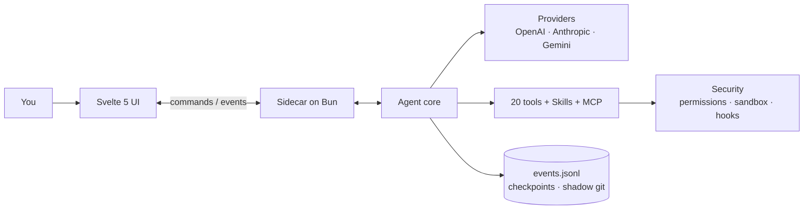

<div align="center">


# Flecten

**为编码智能体打造的桌面工作区。**
对话、文件、工具与变更，尽在一个窗口。

[](https://github.com/AnnenkovLabs/flecten/actions/workflows/ci.yml)
[](../../LICENSE)
[](https://bun.sh)
[](https://www.typescriptlang.org)
[](https://svelte.dev)
[](https://www.electronjs.org)
[](../../CONTRIBUTING.md)

[English](../../README.md) · [简体中文](README.zh-Hans.md) · [Português (Brasil)](README.pt-BR.md) · [Español](README.es.md) · [日本語](README.ja.md) · [Українська](README.uk.md) · [Русский](README.ru.md)

</div>


<p align="center"><sub>使用本地演示提供商的预览。</sub></p>

> [!WARNING]
> **Alpha 版本。** 目前还有大量 bug 和未完成的部分。接下来几天我会全力以赴打磨和完善。预期会有快速迭代，也请[反馈遇到的问题](https://github.com/AnnenkovLabs/flecten/issues)。

## ⚡ 为什么选 Flecten

智能体循环只是基础。Flecten 修复演示之后才暴露的问题。

| 你早已知道的问题 | Flecten 的做法 |
|---|---|
| 🔇 在一个对话里既聊天又写代码会降低两者质量，引导它就得打断它 | **Talker 和 Worker** 作为独立会话运行：继续对话、任务中途引导、只停止 worker |
| 💭 每个新对话都忘记你的项目和你的纠正 | 基于你真实话语的**项目记忆**，跨会话保留 |
| 📖 它误解你项目的术语和行话 | **词典**在回答前把你的准确定义交给模型 |
| 🔌 接入提供商是 JSON 考古 | 粘贴 **base URL 和 API 密钥**；Flecten 配置提供商并从 API 导入全部模型 |
| 🧱 大段结果是一堵 markdown 墙 | **交互式 HTML 回答**：可排序表格、标签页、图表、按钮 |
| 🪞 它像通用助手，而不像你 | **Twin** 学习你的风格，拒绝不像你的成果 |

<p align="center">
<b>20</b> 个内置工具 &nbsp;·&nbsp; <b>4</b> 种提供商协议 &nbsp;·&nbsp; <b>7</b> 种界面语言 &nbsp;·&nbsp; <b>85%</b> 覆盖率门槛
</p>

## 🚀 快速开始

需要 [Bun](https://bun.sh) 1.4 或更新版本。

```bash
bun install
export OPENAI_API_KEY=...
bun run app:dev
```

`bun run app:dev` 会启动 Vite、在 Bun 上运行核心，并打开带热重载的 Electron 窗口。当前目录即项目根目录；设置 `FLECTEN_CWD` 可在其他位置工作。

```bash
# 或另一个提供商
FLECTEN_PROVIDER=anthropic FLECTEN_MODEL=claude-sonnet-4-6 bun run app:dev
```

要在没有核心的浏览器中查看界面，运行 `bun run dev:ui`。

## ✨ Flecten 的与众不同

### 🗣️ 边工作边对话

**Worker 运行时继续对话。**
新对话分为用你语言的 Talker 和领取专注任务的 Worker。任务中途引导、提问，或只停止 Worker。每次调用都是一张带独立日志和停止按钮的实时卡片。

### 🖥️ 一键切换的完整 IDE

**Agent 与 IDE 同窗。**
把顶栏切到 IDE：文件树、编辑器标签页、项目级搜索与替换、跳转到行、源代码管理、终端。对话仍作为一个岛随时可用。

### 🩹 值得信赖的差异

**审查每次编辑，无需 git 手术即可撤销。**
每次变更都以差异呈现，按文件接受或丢弃。保存时核对磁盘版本，冲突绝不会覆盖你的草稿。检查点与影子 git 支撑 `/undo` 和 `/redo`。

### 🧠 跨越对话的记忆

**跨会话记住你的项目。**
由模型决定保留什么：偏好、教训、决定。每条记录基于你的话语，带版本和主题。过时记录自动失效。

### 📖 为你的术语而生的词典

**在调用模型前解析你的词汇。**
涵盖设计与 AI 的公共词典从 GitHub 同步；项目本地术语优先。模糊匹配甚至纠正键盘布局打错的字：`мшиусщвштп` → `vibecoding`。你的消息逐字保留。

### 🔌 一键添加提供商

**从目录选择，而非 JSON。**
添加带标志和模型列表的已知服务，或指向你自己的服务器。Flecten 探测连接并发现模型。四种协议，掉线时可见的故障转移。

### 📊 鲜活的 HTML 回答

**可交互的结果，而不仅是阅读。**
最终回答可以是沙箱化 HTML：可排序表格、标签页、图表，以及打开设置或文件的按钮。随流式传输渲染，无网络、无外部脚本。

### 🪞 它学习你的风格

**像你的 Twin，而非通用助手。**
它从你过去的会话和来源中学习，用你的措辞写规格，拒绝不像你的成果。记忆与画像形成闭环。

## ✅ 以及你期望的一切

| | 领域 | 内容 |
|---|---|---|
| 🛠️ | 工具 | 20 个内置：`read`, `write`, `edit`, `apply_patch`, `delete`, `move`, `todo`, `task`, `grep`, `glob`, `ask`, `web_fetch`, `web_search`, `git`, `lsp`, `terminal`, `bash`, `jobs`, `memory`, `done`；另有 `skill` 和 `module` |
| 🛡️ | 安全 | `deny` / `auto` / `ask` / `allow` 权限、bubblewrap / seatbelt 沙箱、命令钩子，以及在调用内等待的审批 |
| 💻 | 终端 | 每会话一个持久 PTY、带日志和 `wait` 的后台 `jobs`、进程树取消 |
| 🔁 | 运行 | 并行任务、重载后仍存在的队列、steering、核心崩溃后恢复，以及每次运行的 token、成本和时间预算 |
| 🧩 | 扩展 | Agent Skills、带 OAuth 的 stdio / HTTP MCP、钩子，以及打包工具、指令和服务的模块 |
| 📎 | 输入 | 图像、PDF 和音频；对文件、符号、任务和公开 GitHub PR 的 `@` 引用；斜杠菜单；语音输入 |
| 📝 | 输出 | Markdown、Mermaid，以及内置的文件和日志查看器 |
| 🌍 | 覆盖 | 7 种界面语言、签名自动更新、需明确同意的遥测 |

## 🏗️ 架构

界面从不读取文件或调用模型。它通过 JSONL 协议向 Bun 边车发送命令，并接收类型化事件。核心从不导入 Electron 或界面。



事件携带 `seq`、`ts` 和 `schemaVersion`，因此重新打开的窗口能从 `events.jsonl` 重建任务，并从游标处追上实时流。

## 🔗 连接你的技术栈

默认提供商是 `openai`，模型为 `gpt-5.1`。密钥来自环境变量：`OPENAI_API_KEY`, `ANTHROPIC_API_KEY`, `OPENROUTER_API_KEY`, `DEEPSEEK_API_KEY`。任何兼容服务都可在窗口或 `flecten.config.json` 中添加：

```json
{
  "provider": "local",
  "model": "qwen3-coder",
  "providers": {
    "local": {
      "protocol": "openai-chat",
      "baseUrl": "http://127.0.0.1:11434/v1"
    }
  }
}
```

没有密钥的提供商无需认证即可工作，适合本地服务器。高级字段可设置 `headers`、`proxy` 和 `transportTimeoutMs`；密钥可来自 `apiKeyEnv` 或 `auth.command`。在输入框中选择推理级别：`auto`, `low`, `medium`, `high`。

- 🧩 **Skills** 从 `~/.agents/skills` 和项目的 `.agents/skills` 加载；模型看到目录，并按需打开完整的 `SKILL.md`。
- 🔌 **MCP** 服务器暴露其工具、资源和提示词，支持 OAuth discovery 与 PKCE。
- 🪝 **钩子**可以阻止启动、提示词或工具；带 `failClosed` 的钩子在失败时阻止该操作。
- 📦 **模块**打包工具、指令、钩子和服务，在内容审查后按任务激活。

```json
{
  "mcp": {
    "servers": {
      "docs": { "command": "bun", "args": ["mcp/docs-server.ts"] }
    }
  },
  "hooks": {
    "preToolUse": [
      { "command": "bun .agents/hooks/guard.ts", "matcher": "bash" }
    ]
  }
}
```

> ⚠️ 含 MCP、钩子或 skills 的项目配置会启动进程。请只在你信任的仓库中打开。

完整契约：[docs/EXTENSIONS.md](../EXTENSIONS.md)。

## ⌨️ 命令

| 命令 | 作用 |
|---|---|
| `bun run app:dev` | 打开带热重载的 Electron 窗口 |
| `bun run app` | 构建界面和核心，然后打开窗口 |
| `bun run dev:ui` | 在没有 Electron 的浏览器中运行界面 |
| `bun run build:ui` | 构建 `ui/dist` |
| `bun run build:agent` | 将核心二进制构建到 `dist/flecten-agent` |
| `bun test` | 核心与纯界面逻辑的测试 |
| `bun run check` | 运行 `tsc` 和 `svelte-check` |
| `bun run lint` | Biome 与项目规则（文件大小、regex、死模块） |
| `bun run verify` | 测试、类型、lint、文档检查和两次构建 |
| `bun run test:e2e` | Electron 中的 Playwright E2E，含 1480x940 和 1180x640 视觉回归 |
| `bun run coverage` | 对照 85% 门槛检查行覆盖率 |
| `bun run package` | 在 `release/` 创建未打包的 Electron 包 |
| `bun run release` | 为当前平台创建安装器 |

变更未通过 `bun run verify` 就不算完成。

## 📚 文档

- 🏗️ [架构](../ARCHITECTURE.md) · 🗣️ [Talker 与 Worker](../TALKER-WORKER.md) · 🧠 [记忆](../MEMORY.md) · 📖 [词典](../DICTIONARY.md)
- 🧩 [扩展](../EXTENSIONS.md) · 📦 [模块](../MODULES.md) · 🎙️ [语音](../VOICE.md)
- 🗂️ [结构](../STRUCTURE.md) · 🎨 [设计](../../design.md) · 📐 [约定](../CONVENTIONS.md)
- 🚢 [发布](../RELEASE.md) · 📝 [Changelog](../../CHANGELOG.md) · 🖼️ [界面指南](../../ui/README.md) · 🐚 [外壳指南](../../shell/README.md)

## 🚦 状态

智能体基础已可工作，并由测试和快照覆盖。进行中：发布签名、Windows 沙箱、按命令的资源隔离，以及原生平台验收测试。Windows PTY 使用 Bun 1.4.2 的 ConPTY。

自动更新使用 `FLECTEN_UPDATE_URL`，并在下载安装器之前用内置公钥验证 Ed25519 清单。

## 🤝 参与贡献

开 PR 前请阅读 [CONTRIBUTING.md](../../CONTRIBUTING.md) 和 [CODE_OF_CONDUCT.md](../../CODE_OF_CONDUCT.md)。按 [SECURITY.md](../../SECURITY.md) 报告漏洞，不要在公开 issue 中提出。

## 📄 许可证

AGPL-3.0。见 [LICENSE](../../LICENSE)。可自由使用、修改和分享；社区规范见 [ETHICS.md](../../ETHICS.md) 和[行为准则](../../CODE_OF_CONDUCT.md)。

---

<p align="center"><sub>Flecten 之前名为 Liquid Harness。现有的 <code>liquid.config.json</code> 文件、<code>LIQUID_*</code> 变量、<code>liquid-harness://</code> 链接和已保存的画像仍然可用。主要名称现在是 <code>flecten.config.json</code>、<code>FLECTEN_*</code> 和 <code>flecten://</code>。<code>.liquid/</code> 文件夹保留会话、附件和检查点，无需数据迁移。</sub></p>

<p align="center"><sub>界面以英语启动。在<b>设置 → 通用 → 界面语言</b>中选择语言。选择保存在本设备上，与智能体回答的语言相互独立。</sub></p>
